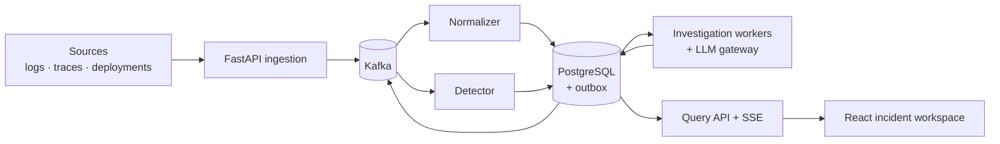

# SignalOps

SignalOps turns noisy telemetry into evidence-backed software incident diagnoses.

It ingests logs, trace summaries, and deployment events, detects incidents with deterministic time-window rules, and runs bounded, budgeted agent investigations. Each investigation returns a validated diagnosis that cites evidence, or an explicit *insufficient evidence* result. A replay-based evaluation lab scores diagnoses against injected faults.

> **Status: Phases 1–11 of 12 complete.** Ingestion, detection, the temporal service graph, durable single- and multi-agent investigations, the live incident workspace, the evaluation lab, observability, and recovery procedures run on Docker Compose. By default a deterministic fake plays the model: it proves the plumbing and says nothing about diagnostic quality. A Claude adapter exists; no paid model run is part of the recorded results. See the [progress ledger](docs/development_roadmap.md#progress-ledger).

## What it does



1. **Ingest:** source adapters submit batches with stable event IDs. The API returns *accepted* only after Kafka acknowledges.
2. **Normalize:** a worker validates and scores data quality, resolves service identity, and writes evidence to PostgreSQL. Idempotency comes from consumer receipts.
3. **Detect:** durable error and latency windows group signals into one correlated incident.
4. **Investigate:** a durable job runs an explicit, checkpointed workflow. Agents use read-only, scope-bounded tools through a budgeted model gateway.
5. **Explain:** the UI shows the timeline, the service graph, live agent progress, the diagnosis with clickable evidence, uncertainty, and cost.
6. **Evaluate:** isolated replays compare deterministic, single-agent, and multi-agent baselines under equal constraints.

## Stack

| Layer | Technology |
| --- | --- |
| Frontend | React, TypeScript (`apps/web`, pnpm) |
| Backend | Python, FastAPI, Pydantic, SQLAlchemy, Alembic (`backend/signalops`, uv) |
| Event backbone | Apache Kafka (single-node KRaft for development) |
| Durable state | PostgreSQL: evidence, incidents, jobs, checkpoints, budgets, graph |
| Disposable state | Redis: caches, rate limits, UI wake-ups |
| Runtime | Docker Compose, one backend image with separate process commands |

## Documentation

| Document | Contents |
| --- | --- |
| [Quick start](docs/quickstart.md) | Run the fake-provider demonstration end to end; environment and settings |
| [Architecture](docs/architecture.md) | Components, process boundaries, ownership of state, event flow |
| [Events](docs/events.md) | Kafka topics, keys, the common envelope, delivery and failure rules |
| [Data model](docs/data-model.md) | PostgreSQL tables, constraints, temporal graph, indexes, ER diagram |
| [Agents and workflow](docs/agents-and-workflow.md) | Workflow nodes, agent roles, tools, gateway, budgets, diagnosis contract |
| [API](docs/api.md) | HTTP endpoints, idempotency, SSE progress stream, error categories, examples |
| [Reliability](docs/reliability.md) | Outbox, receipts, offsets, leases, recovery guarantees, outage checks |
| [Runbook](docs/runbook.md) | Operating the local deployment: symptoms, checks, and actions |
| [Observability](docs/observability.md) | Metrics, dashboards, correlation fields, following a fault |
| [Security](docs/security.md) | Principals, credentials and rotation, limits, redaction |
| [Retention](docs/retention.md) | Retention cleanup, backup and restore, single-node limits |
| [Evaluation](docs/evaluation.md) | Fault scenarios, baselines, metrics, leakage prevention |
| [Benchmarks](docs/benchmarks.md) | One-million-record replay and 30-minute sustained run, with retained reports |
| [Development](docs/development.md) | Repository layout, commands, configuration reference, conventions |
| [Decisions](docs/decisions.md) | Architecture decision records |

Planning sources:

- [Implementation plan](docs/SignalOps_Implementation_Plan.md): the original design (v1, 16 Oct 2026).
- [Development roadmap](docs/development_roadmap.md): 12 phases, task IDs, acceptance criteria, and the progress ledger.
- [CLAUDE.md](CLAUDE.md): project instructions for AI-assisted development.

## Quick start

Requires Docker with Compose v2. No model API key is needed: the deterministic fake provider is the default.

```bash
./scripts/init-env.sh                                  # .env with random local tokens; prints the operator token
docker compose up -d --build --wait                    # infrastructure, migrations, topics, API, UI, workers
docker compose --profile demo run --rm demo-seed       # demo workspace, sources, services
docker compose --profile demo run --rm demo \
  demo-post downstream-timeout --realtime --duration-s 300 --api-url http://api:8000
```

Open <http://127.0.0.1:8090/incidents>, paste the operator token, and open the incident that appears about two minutes into the fault. Its investigation runs automatically. The full walkthrough, API examples, a worker-crash exercise, and the environment guide are in [docs/quickstart.md](docs/quickstart.md).

Stop with `docker compose down`; add `-v` only to delete the data volumes. For checks and running processes on the host (uv, pnpm), see [Development](docs/development.md).

## Scope

**In scope for the first releases:** one workspace, three adapters (logs, traces, deployments), read-only investigations, and remediation that only a human applies.

**Explicitly not claimed:**

- Production high availability from single-node Compose.
- Exactly-once model execution.
- Diagnostic accuracy: recorded evaluation runs used the fake provider. Throughput figures are limited to the retained [benchmark reports](docs/benchmarks.md) on the documented hardware.

**Deferred:** a metrics adapter (after R1), a dedicated graph database, Kubernetes, multi-broker Kafka, and autonomous remediation. See the [deferred backlog](docs/development_roadmap.md#deferred-backlog).

| Release | Phases | Gate |
| --- | --- | --- |
| R0 Data platform | 1–5 | Fault signals produce a durable incident with inspectable evidence |
| R1 First portfolio slice | 1–8 | One agent diagnoses a fault with evidence in the UI |
| R2 Multi-agent platform | 9 | Specialist workflow survives a worker crash |
| R3 Evaluated release | 10–12 | Held-out comparisons, load results, reproducible demo |
