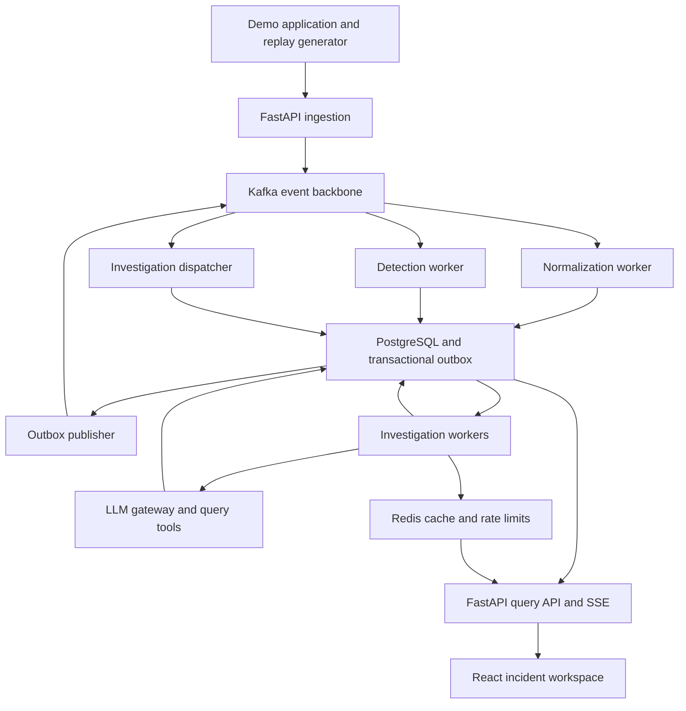
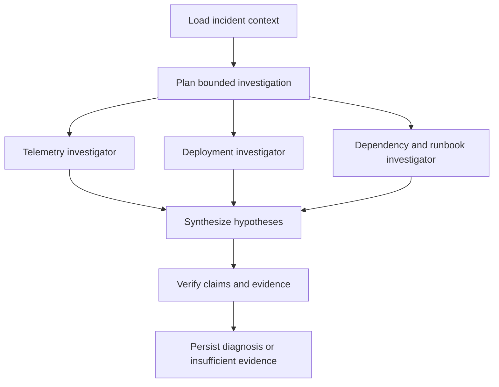

# SignalOps implementation plan

Version 1 • 16 October 2026 • Portfolio and learning project

## 1 Purpose and scope

Build a platform that turns noisy telemetry and deployment events into evidence-backed incident diagnoses. Use React and TypeScript, Python and FastAPI, Apache Kafka, PostgreSQL, Redis, and Docker Compose. Demonstrate a complete investigation before expanding source count or throughput.

The first release ingests logs, trace summaries, and deployment events from a controlled application. It detects incidents, runs bounded multi-agent investigations, presents evidence and uncertainty, and evaluates results against injected faults. Metrics are added through a fourth adapter after the first working slice.

Scope boundaries: read-only investigations; proposed remediation requires human execution. One workspace initially. No autonomous production changes. No claim of production high availability from a single-machine Compose deployment. Millions of events are a later measured replay workload; thousands of sources are an extension target, not an MVP claim.

## 2 Architecture



Kafka transports accepted raw signals and domain events. PostgreSQL owns durable application state, including normalized evidence, investigations, agent checkpoints, graph relationships, and evaluation records. Redis accelerates operations but does not own job state or evidence. The runtime is the investigation worker plus its persisted state machine; the LLM gateway is its model access boundary.

### Process boundaries

| Process | Responsibility | Scaling boundary |
| --- | --- | --- |
| FastAPI | Ingestion, query endpoints, investigation requests, SSE | HTTP replicas |
| Normalizer | Adapter validation, identity resolution, quality scoring | Kafka partitions |
| Detector | Time-window rules and incident grouping | Kafka partitions plus durable detector state |
| Dispatcher | Convert investigation events to durable jobs | Kafka partitions |
| Investigation worker | Claim jobs, execute agent steps, checkpoint | Worker concurrency and model budget |
| Outbox publisher | Publish committed domain events | Independent polling process |
| Evaluation runner | Fault injection, replay, scoring | Isolated evaluation runs |

Use one Python codebase with separate commands and containers. Agents are logical roles, not separate microservices. Use Pydantic contracts, SQLAlchemy and Alembic for persistence, and a Python Kafka client. Pin compatible dependency and container versions during implementation; this document intentionally does not prescribe current version numbers.

## 3 End to end behavior

1. A source adapter submits a batch with stable source event identifiers. FastAPI validates envelope size and credentials, redacts configured sensitive fields, and publishes to Kafka. Return accepted only after broker acknowledgement; report partial batch outcomes explicitly.
2. The normalizer validates the source payload, resolves service identity, assigns quality flags, and atomically inserts the normalized signal, consumer receipt, and outbox event in PostgreSQL. Commit Kafka offsets only after the database transaction commits.
3. The detector consumes normalized event references, loads evidence, updates durable window state, and upserts an incident by fingerprint and correlation window. It creates an investigation and an outbox request in the same transaction when the rule crosses its threshold.
4. The dispatcher records a durable job before acknowledging the request. A worker claims that job using a database lease and starts the workflow. Kafka consumption never waits for the complete LLM investigation.
5. Investigators query bounded evidence windows and graph neighborhoods. The verifier checks claim support, competing hypotheses, and output schema. Persist a structured diagnosis or an explicit insufficient-evidence result.
6. Durable progress events update the UI. A developer applies a suggested fix in the demo application; SignalOps observes recovery and records the outcome.

## 4 Kafka event contracts

### Topics and ordering

| Topic | Message key | Consumers |
| --- | --- | --- |
| signals.raw.v1 | source_id plus service hint | normalizer-v1 |
| signals.normalized.v1 | workspace_id plus service_id | detector-v1; later graph-projector-v1 |
| incidents.changed.v1 | incident_id | notification-projector-v1 |
| investigations.requested.v1 | investigation_id | dispatcher-v1 |
| investigations.completed.v1 | investigation_id | evaluation-projector-v1 |
| processing.failed.v1 | original event_id | failure triage and controlled replay |

Different consumer groups receive the same event independently; members of one group share partitions. Ordering is only per partition. No global order across sources is assumed. Start with three partitions for signal topics and one for low-volume domain topics; measure before changing. A key change or partition-count change requires reviewing ordering assumptions.

### Common envelope

```json
{
  "event_id": "e7cacb54-6312-45e0-945b-96dd98dd3aec",
  "event_type": "signal.normalized",
  "schema_version": 1,
  "workspace_id": "82631aa1-86f5-4d37-b39f-fac74ebbdac8",
  "source_id": "b6c72d79-7ec9-4df7-88d0-1d4332c88808",
  "occurred_at": "2026-10-16T10:40:00Z",
  "ingested_at": "2026-10-16T10:40:01Z",
  "correlation_id": "checkout-latency-demo-001",
  "causation_id": "original-envelope-event-id",
  "trace_id": "optional-trace-id",
  "replay_run_id": null,
  "payload": {
    "signal_id": "37575f37-98af-4cb8-a875-26c3dde75ec7",
    "service_id": "dc2bf08d-6c3c-44ea-855a-d7d42eeefb36",
    "kind": "log",
    "quality_status": "accepted"
  }
}
```

Raw payloads are adapter-specific; normalized events carry evidence identifiers rather than repeating large payloads. Define Pydantic models for each event type, export JSON Schema, and check fixtures in CI. Permit additive optional fields in v1; introduce a new version and explicit adapter for breaking changes. Unknown supported-envelope payload fields are preserved in attributes; unsupported versions are quarantined.

### Delivery and failure rules

Use producer idempotence and acknowledgements from all available in-sync replicas. Local Kafka has one broker and replication factor one; this does not protect against host or disk loss. Persistent volumes survive container recreation, not arbitrary machine failure.

Assume at-least-once consumption. Kafka producer idempotence does not make PostgreSQL writes or model calls exactly once. Consumer receipts and domain uniqueness constraints make application effects idempotent. Keep receipt retention at least as long as the replay horizon or retain equivalent durable business keys.

The outbox publishes after database commit and marks delivery only after acknowledgement. A crash between these steps may republish; consumers deduplicate. Publish a bounded batch sequentially per aggregate for the MVP, with one publisher, so parallel relays cannot reorder an aggregate's events.

Transient failures receive capped exponential backoff with jitter. Start with five attempts and a 30-second maximum delay; persist long delays in job state rather than sleeping through consumer poll deadlines. Permanent validation failures go to processing.failed.v1 with redacted error information and original identifiers. If publishing the failure event fails, do not acknowledge the original. Redrive preserves the original event ID and records a separate redrive attempt ID.

## 5 PostgreSQL logical data model

UUID primary keys, UTC timestamptz timestamps, JSONB for source-specific attributes, explicit foreign keys, and integer minor currency units for budgets. The following is a logical schema specification, not a complete executable migration. Every workspace-owned relationship must be validated against workspace_id; use composite foreign keys or equivalent transactional validation before multi-workspace support.

### Sources and evidence

| Table | Fields and constraints |
| --- | --- |
| workspaces | id UUID PK; name text; created_at timestamptz |
| sources | id UUID PK; workspace_id FK; name text; kind text; config JSONB; enabled boolean; created_at; UNIQUE(workspace_id, name). Store secret references, never credentials, in config. |
| services | id UUID PK; workspace_id FK; name text; environment text; attributes JSONB; UNIQUE(workspace_id, name, environment) |
| signals | id UUID PK; workspace_id FK; source_id FK; service_id nullable FK; source_event_id text; kind text; occurred_at; ingested_at; severity text; message text; trace_id nullable text; attributes JSONB; quality_status text; quality_flags JSONB; replay_scope text NOT NULL DEFAULT 'live'; UNIQUE(source_id, replay_scope, source_event_id) |
| deployments | id UUID PK; workspace_id FK; service_id FK; signal_id UNIQUE FK; revision text; deployed_at; attributes JSONB |
| signal_aggregates | id UUID PK; service_id FK; replay_scope text; metric_name text; window_start; window_end; sample_count bigint; error_count bigint; value_sum double precision; histogram JSONB; UNIQUE(service_id, replay_scope, metric_name, window_start) |

source_event_id must be stable across retries. If an upstream source lacks IDs, define an adapter-specific identity strategy and document its collision or duplicate limitations. Do not hash message text alone: identical messages may be legitimate separate events. replay_scope isolates benchmark copies from live events and other evaluation runs.

Use CHECK constraints for signal kind, severity, and quality status; reject negative counters and invalid windows. Missing service identity can be quarantined or retained as degraded evidence, depending on the detector rule. Do not silently assign an arbitrary service.

### Incidents and investigations

| Table | Fields and constraints |
| --- | --- |
| incidents | id UUID PK; workspace_id FK; replay_scope text; fingerprint text; correlation_window_start; title text; severity text; status text; detected_at; first_seen_at; last_seen_at; resolved_at nullable; version integer; UNIQUE(workspace_id, replay_scope, fingerprint, correlation_window_start) |
| incident_services | incident_id FK; service_id FK; role text; PRIMARY KEY(incident_id, service_id) |
| incident_signals | incident_id FK; signal_id FK; relevance double precision; PRIMARY KEY(incident_id, signal_id) |
| investigations | id UUID PK; incident_id FK; request_key text UNIQUE; status text; workflow_version text; budget_microusd bigint; reserved_microusd bigint; spent_microusd bigint; max_steps integer; deadline_at; created_at; completed_at nullable; diagnosis JSONB; version integer |
| jobs | id UUID PK; investigation_id UNIQUE FK; status text; available_at; attempts integer; max_attempts integer; lease_owner nullable text; lease_until nullable timestamptz; lease_generation bigint; last_error nullable JSONB |
| agent_steps | id UUID PK; investigation_id FK; step_key text; agent_role text; status text; attempt integer; input JSONB; output JSONB; checkpoint JSONB; lease_generation bigint; started_at; completed_at nullable; UNIQUE(investigation_id, step_key) |
| tool_calls | id UUID PK; agent_step_id FK; call_key text; tool_name text; arguments JSONB; result_ref nullable text; status text; duration_ms integer; UNIQUE(agent_step_id, call_key) |
| llm_calls | id UUID PK; agent_step_id FK; attempt integer; provider text; model text; prompt_version text; request_hash text; status text; input_tokens integer; output_tokens integer; reserved_microusd bigint; cost_microusd bigint; latency_ms integer; provider_request_id nullable text; UNIQUE(agent_step_id, attempt) |
| progress_events | id bigint identity PK; investigation_id FK; event_type text; payload JSONB; created_at |

Investigation states: queued, running, completed, insufficient_evidence, failed, cancelled, budget_exceeded. Job states: queued, running, succeeded, failed, cancelled. Step states: pending, running, completed, failed, skipped. Enforce these enumerations and allowed transitions in the persistence layer. Store the current structured finding rather than unrestricted hidden model reasoning.

### Knowledge graph in PostgreSQL

| Table | Fields and constraints |
| --- | --- |
| graph_nodes | id UUID PK; workspace_id FK; node_type text; external_key text; properties JSONB; UNIQUE(workspace_id, node_type, external_key) |
| graph_edges | id UUID PK; workspace_id FK; from_node_id FK; to_node_id FK; relation text; valid_from; valid_to nullable; confidence double precision; provenance_signal_id nullable FK; properties JSONB |

Node types: service, deployment, incident, runbook. Relationships: DEPENDS_ON, DEPLOYED_TO, AFFECTS, DOCUMENTED_BY. Use explicit node foreign keys rather than unchecked polymorphic identifiers. Link a service graph node through a stable external_key containing its service UUID. Multiple observations may support one relationship; preserve provenance and coalesce duplicates in the projector. An observed dependency or temporal correlation is not proof of causation.

Use adjacency queries and bounded recursive CTEs, initially up to three hops with cycle prevention and row limits. Query graph edges as of the incident time using valid_from and valid_to. Adopt a dedicated graph database only when measured traversal complexity warrants a separate projection.

### Reliability and evaluation

| Table | Fields and constraints |
| --- | --- |
| consumer_receipts | consumer_group text; event_id UUID; processed_at; PRIMARY KEY(consumer_group, event_id) |
| outbox_events | id UUID PK; aggregate_id UUID; aggregate_version bigint; topic text; message_key text; envelope JSONB; created_at; published_at nullable; attempts integer; UNIQUE(aggregate_id, aggregate_version, topic) |
| evaluation_scenarios | id UUID PK; name text; version text; dataset_ref text; injection_spec JSONB; expected_outcome JSONB; UNIQUE(name, version) |
| evaluation_runs | id UUID PK; scenario_id FK; system_variant text; workflow_version text; model_config JSONB; prompt_versions JSONB; dataset_hash text; seed integer; started_at; completed_at; metrics JSONB |
| evaluation_cases | id UUID PK; run_id FK; case_key text; investigation_id nullable FK; expected_outcome JSONB; observed_outcome JSONB; scores JSONB; UNIQUE(run_id, case_key) |

Ground truth belongs to the evaluation runner. Investigation tools must not expose expected_outcome, injection labels, or future signals. Give the runtime database role no access to evaluation ground-truth tables.

### Initial indexes and retention

- signals(service_id, occurred_at DESC), signals(source_id, ingested_at DESC), and a partial trace_id index for non-null values.
- incidents(status, detected_at DESC), jobs(status, available_at), and a partial jobs(lease_until) index for running jobs.
- agent_steps(investigation_id, status), progress_events(investigation_id, id), and a partial outbox_events(created_at) index WHERE published_at IS NULL.
- graph_edges(from_node_id, relation) and graph_edges(to_node_id, relation). Add selective JSONB indexes only after query profiling.
- Initial local retention targets: Kafka raw events 3 days; normalized events 7 days; PostgreSQL detailed signals 7 days; aggregates 30 days. Keep benchmark fixtures and summarized evaluation results separately. Before deleting evidence cited by a diagnosis, preserve its redacted excerpt, content hash, and provenance or mark it expired in the UI.
- PostgreSQL is sufficient for initial bounded datasets. Benchmark before adding date partitions, external object storage, or a telemetry analytics database. It is not a claim that PostgreSQL JSONB alone is the final storage design for unlimited telemetry.

## 6 Redis responsibilities

| Key pattern | Value | Expiration and recovery |
| --- | --- | --- |
| cache:service:{id}:context:{version} | Bounded service context JSON | 60–300 seconds; reload from PostgreSQL |
| cache:query:{scope}:{hash} | Read-only tool result | 30–120 seconds; scope includes incident time, replay run, and data version |
| limit:provider:{provider}:{window} | Request and token reservations | Atomic operation with expiry; gateway delays when unavailable |
| limit:ingest:{source}:{window} | Ingestion request counter | Short TTL; return 429 when limit exceeded |
| ui:investigation:{id} | Pub/sub notification channel | No durable history; PostgreSQL progress_events supplies recovery |

Use atomic Lua scripts or equivalent atomic operations for multi-field rate limits. Never rely on Redis cache TTLs for investigation correctness. Durable monetary budget reservations live in PostgreSQL. Redis loss may cause cache misses or temporarily pause model calls; it must not erase investigations. Redis pub/sub is only a wake-up mechanism. SSE reconnects use Last-Event-ID to fetch missed progress_events; periodic database catch-up also covers notifications missed without a disconnect.

## 7 Agent workflow and LLM gateway

### Workflow



Implement an explicit Python state machine first. Each node has a typed input/output contract and a persisted checkpoint. Only unfinished nodes resume after a crash. Use at most three concurrent investigators per incident initially; no unrestricted recursive agent spawning. A verifier may request one bounded follow-up round if the remaining budget permits it.

Tools: query_logs, get_trace_summary, get_deployments, get_service_dependencies, retrieve_runbooks. Each tool enforces workspace and replay scope, incident cutoff time, bounded time range, row and byte limits, timeout, and redaction. Treat source text and runbooks as untrusted data; instructions embedded in evidence cannot expand tool permissions.

The gateway centralizes model routing, timeouts, provider rate limiting, retry policy, structured output validation, prompt versions, usage attribution, and logging. Implement it as a Python module first; extract a service only when multiple runtimes need it. Provider credentials stay server-side.

Before each call, reserve an upper cost bound atomically against the investigation budget and enforce input/output token limits. Include parallel in-flight calls in reservations. Reconcile actual usage on completion. An ambiguous provider timeout may already have incurred cost: record an unknown outcome, preserve its reservation conservatively, and count any retry as another possible billable call. Local request hashes alone do not guarantee provider-side deduplication.

### Diagnosis contract

```json
{
  "status": "diagnosed",
  "summary": "Checkout failures correlate with the new payment deployment.",
  "root_cause": {
    "service": "payment",
    "failure_type": "connection_pool_exhaustion",
    "confidence": 0.82,
    "evidence_signal_ids": ["signal-uuid-1", "signal-uuid-2"]
  },
  "alternatives": [
    {"hypothesis": "Database outage", "assessment": "Not supported by observed database health"}
  ],
  "suggested_actions": [
    {"action": "Review pool settings and consider reverting the deployment", "requires_approval": true}
  ],
  "limitations": ["No database connection metrics were available"],
  "workflow_version": "v1"
}
```

This is an illustrative response shape; examples use placeholder evidence IDs. The implementation validates UUIDs, verifies cited evidence exists within scope, and bounds confidence to 0–1. Confidence is a model assessment until calibrated with evaluation results. Unsupported diagnoses return status insufficient_evidence, null root_cause, and explicit missing evidence.

## 8 Durable execution and recovery

A worker claims an available job using SELECT FOR UPDATE SKIP LOCKED, sets a lease, increments lease_generation, and commits before external calls. It heartbeats while running. Every checkpoint and completion update checks the owner and lease_generation, preventing an expired worker from overwriting a newer worker's progress. External model calls can still overlap after lease loss, so enforce provider request deadlines and conservative budget reservations.

Persist each completed step and reuse its validated output on restart. The system guarantees durable checkpoint reuse, not exactly-once execution of an external LLM request. Use optimistic version checks for concurrent incident changes and cancellation. Check cancellation before starting each new call and between workflow nodes.

For detector state, insert the consumer receipt and update the aggregate in one transaction. A Redis-only window would lose correctness after restart. Initially accept events up to 30 seconds late: update affected windows and idempotently recompute the rule. Record older events for evidence with a late flag, but do not silently create historical incidents. Replay uses an explicit simulated clock and flushes final windows; live execution uses wall-clock window closure.

## 9 HTTP API and frontend

| Endpoint | Behavior |
| --- | --- |
| POST /v1/ingest/{source_id} | Bounded batch ingestion; per-record acceptance result |
| GET /v1/incidents | Cursor pagination and service, severity, status filters |
| GET /v1/incidents/{id} | Timeline, affected services, evidence references |
| POST /v1/incidents/{id}/investigations | Idempotency-Key; 202 with investigation ID |
| GET /v1/investigations/{id} | State, finding, evidence, usage, limitations |
| POST /v1/investigations/{id}/cancel | Persist cancellation request |
| GET /v1/investigations/{id}/events | SSE with durable reconnect cursor |
| GET /v1/services/{id}/graph | Bounded neighborhood as of a timestamp |
| POST /v1/evaluation-runs | Start an isolated scenario run |
| GET /v1/evaluation-runs/{id} | Case results and aggregate metrics |

MVP UI: incident list, incident timeline, service graph, agent progress, diagnosis with clickable evidence, token/cost panel, and evaluation comparison. Display the incident evidence cutoff, data quality flags, and uncertainty. The request idempotency key is scoped to the caller and route; store its request-body hash and reject reuse with a different body.

Use authenticated operator access before exposing the demo publicly. Apply source-specific ingestion credentials, scope checks, request-size limits, and query limits. Keep local development services on private Compose networks; do not expose PostgreSQL, Kafka, or Redis publicly.

## 10 Docker Compose and repository layout

Core services: frontend, api, normalizer, detector, dispatcher, investigation-worker, outbox-publisher, postgres, redis, kafka. Use one backend image with different entry commands. Add one-shot migrate and init-topics services; optional profiles demo, evaluation, and observability keep ordinary startup light.

Kafka uses a single-node KRaft configuration for development. Configure internal container and optional host listeners correctly. PostgreSQL, Kafka, and Redis use named volumes; application correctness must survive an empty Redis volume. Add dependency health checks, client reconnects, graceful shutdown, and bounded database connection pools. Apply migrations through the one-shot service rather than from every API replica. Use FastAPI lifespan for connection startup and shutdown, not for running the durable investigation loop.

```text
signalops/
  apps/web/                   React and TypeScript
  backend/signalops/
    api/                      HTTP and SSE
    contracts/                Pydantic models and JSON Schemas
    adapters/                 Logs, traces, deployments
    streaming/                Kafka consumers and outbox
    detection/                Rules and window state
    agents/                   Workflow nodes and tools
    gateway/                  Model calls and budgets
    persistence/              SQLAlchemy models and repositories
    evaluation/               Replay and scoring
  migrations/                 Alembic revisions
  fixtures/                   Versioned synthetic scenarios
  tests/                      Reliability and evaluation checks
  infra/                      Compose and telemetry configuration
  docs/                       Architecture decisions and demo guide
```

Use a small synthetic application first. The OpenTelemetry Demo can be integrated through the demo profile when machine resources allow. Avoid making the full demo stack a prerequisite for every developer command.

## 11 Implementation milestones

Effort ranges are planning estimates for one developer, not deadlines. Total approximately 28–43 focused development days; reduce optional scope if needed.

| Phase | Estimate | Deliverable and exit criterion |
| --- | --- | --- |
| 1 Foundation | 2–3 days | Compose, FastAPI, React, PostgreSQL migrations, Redis, Kafka; clean startup and health checks |
| 2 Data pipeline | 4–6 days | Three adapters, contracts, quality flags, receipts, outbox; duplicates and restarts preserve logical counts |
| 3 Detection and graph | 4–6 days | Deterministic error/latency rules, incident grouping, temporal graph; injected incident appears with correct evidence |
| 4 First investigation | 4–6 days | One tool-using agent, gateway, budget tracking, durable jobs, UI evidence view; complete end-to-end diagnosis |
| 5 Multi-agent runtime | 5–8 days | Specialist roles, verifier, checkpoints, leases, cancellation; kill and resume without rerunning completed steps |
| 6 Evaluation lab | 5–8 days | Versioned fault scenarios, isolated replay, three baselines, result dashboard; reproducible comparison with no ground-truth leakage |
| 7 Portfolio release | 4–6 days | Load report, failure demonstrations, polished UI, architecture decisions, short demo recording |

Milestone 4 is the first publishable portfolio version. Do not postpone it for a dedicated graph database, Kubernetes, or additional orchestration infrastructure.

## 12 Evaluation and measurable acceptance

Create at least five fault families: downstream timeout, connection pool exhaustion, deployment regression, memory pressure, and healthy traffic with noisy warnings. Include mixed and insufficient-evidence cases. Separate scenario variants used for development from held-out variants used for reporting; do not tune prompts on all test cases.

Compare deterministic rules, one tool-using agent, and the multi-agent workflow with the same evidence cutoff, tools, dataset, and total token budget. Report correctness together with latency and cost. Repeat model runs and report sample size and variability.

| Metric | Definition |
| --- | --- |
| Detection precision and recall | Correct detected incident windows and affected services against scenario labels |
| Root-cause accuracy | Correct service plus failure type on diagnosable cases |
| Evidence precision | Supported cited claims divided by all audited cited claims |
| Unsupported diagnosis rate | Diagnoses asserting causes absent from available evidence |
| Abstention quality | Insufficient-evidence decisions on intentionally underdetermined cases |
| Diagnosis latency | Durable diagnosis timestamp minus incident detection timestamp; p50 and p95 |
| Cost per investigation | Provider-attributed usage cost, including retries and recorded ambiguous calls |
| Recovery correctness | Completed checkpoints reused; no duplicate logical jobs or incident links |
| Data quality | Invalid, unresolved, late, duplicate, and quarantined events by source |

Initial engineering targets, to validate rather than advertise as achieved: replay one million synthetic signals in a bounded dataset; sustain 100 events/second for 30 minutes on documented hardware; no lost accepted logical events within the declared retention window; no duplicate logical records after redelivery. Measure Kafka lag, PostgreSQL latency, API p95, memory, CPU, and actual storage growth. Count accepted events and reconcile every one as processed or explicitly quarantined after lag drains.

Agent latency and accuracy targets should follow the first baseline run. A multi-agent variant is retained only if it improves quality, robustness, or useful parallelism enough to justify its cost.

## 13 Verification and release checklist

- Contract fixtures cover missing fields, unsupported versions, malformed timestamps, oversized payloads, and contradictory service identities.
- Inject a duplicate Kafka message and crash after database commit but before offset commit; verify one logical effect.
- Crash the outbox publisher after broker acknowledgement; verify duplicate publication is harmless.
- Kill an investigation worker after one completed step; expire its lease and verify checkpoint reuse and stale-writer rejection.
- Simulate provider throttling, ambiguous timeout, malformed structured output, and parallel budget exhaustion.
- Restart Redis during an investigation; verify durable work survives and SSE catches up.
- Test late and out-of-order signals and replay isolation; ensure agents cannot query future evidence or ground truth.
- Run a held-out benchmark and retain dataset hashes, prompt versions, model configuration, seed, hardware, and costs.
- Document local single-node durability limits, retention, backup and restore instructions, and measured scaling limits.

## 14 Portfolio deliverables

Publish a repository with a quick-start guide, architecture and event diagrams, migrations, sample contracts, reproducible scenarios, benchmark results, and a short recorded investigation. Include concise architecture decisions explaining Kafka versus Redis responsibilities, PostgreSQL graph trade-offs, at-least-once handling, budget reservations, and why multi-agent execution helped or failed to help.

The strongest demonstration is a visible injected fault, a noisy event stream, a justified diagnosis with evidence links, a worker crash and successful resume, and a comparison against the simpler baseline. Label synthetic traffic and benchmark limitations clearly.

## 15 Technical references

These references support infrastructure behavior; schema and workflow choices above are proposed project design decisions.

- OpenTelemetry Demo: https://opentelemetry.io/docs/demo/ — controlled application and failure scenarios.
- Apache Kafka design: https://kafka.apache.org/43/design/design/ — consumer groups, partition ordering, delivery semantics, and producer idempotence.
- Redis pub/sub: https://redis.io/docs/latest/develop/use-cases/pub-sub/ — ephemeral notifications and at-most-once delivery.
- FastAPI lifespan: https://fastapi.tiangolo.com/advanced/events/ — application resource initialization and shutdown.
