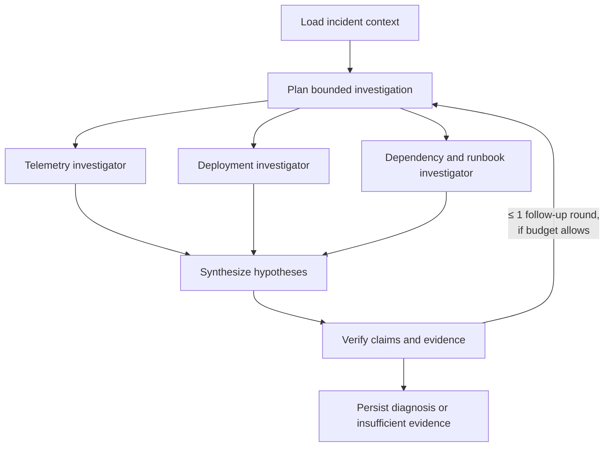

# Agents and workflow

> Status: planned design. The source is [SignalOps_Implementation_Plan.md](SignalOps_Implementation_Plan.md) §7–8. Delivery order: durable runtime (Phase 6), gateway and one agent (Phase 7), multi-agent (Phase 9).

## Principles

- **A single agent comes first.** Start with one tool-using agent on the fake provider. Add specialists, synthesis, and verification only after the single-agent slice works end to end.
- **The workflow is an explicit Python state machine.** It is not a generic agent framework. Every node has typed input and output contracts and a persisted checkpoint.
- **Agents are logical roles** inside the investigation worker, not separate services.
- **Everything is bounded:** steps, output tokens, concurrency, per-call timeouts, an overall deadline, and money.
- **Evidence is untrusted data.** Log lines and runbooks cannot grant tools or widen scope. Authorization lives in code.

## Workflow



- An investigation runs **at most 3 concurrent specialist branches**. Specialists never spawn agents recursively.
- The verifier may request **one** bounded follow-up round, and only within the remaining budget and deadline.
- Downstream capacity for synthesis and verification is reserved up front, so specialists cannot exhaust the budget first.

The engine exists (P06-T03, ADR-022) with a three-node fake sequence: `load_context`, `investigate`, `conclude`. `investigate` makes no model call and always abstains, so every finished investigation ends `insufficient_evidence`. Phase 7 replaces it, and Phase 9 adds the branches above.

## Roles

| Role | Responsibility | Output |
| --- | --- | --- |
| Coordinator | Load incident context, plan branches | Investigation plan |
| Telemetry investigator | Error and latency patterns, logs, trace summaries | Typed findings with evidence IDs |
| Deployment investigator | Recent deployments and revisions near the incident window | Typed findings with evidence IDs |
| Dependency and runbook investigator | Graph neighborhood as of incident time, relevant runbooks | Typed findings with evidence IDs |
| Synthesizer | Merge compatible findings, surface contradictions | Ranked hypotheses |
| Verifier | Check citation support, competing hypotheses, schema | Verified diagnosis or abstention |

Each role receives only the context it needs. Its prompt and output schema are versioned.

## Tools

All tools are **read-only** and typed. Each call enforces workspace scope, replay scope, the incident evidence cutoff, a bounded time range, row and byte caps, a timeout, and redaction.

| Tool | Reads |
| --- | --- |
| `query_logs` | Normalized log signals for services and windows |
| `get_trace_summary` | Trace summaries by trace ID or service |
| `get_deployments` | Deployments before the cutoff |
| `get_service_dependencies` | Bounded graph neighborhood (≤ 3 hops) as of incident time |
| `retrieve_runbooks` | Versioned runbook content with provenance |

No tool exposes SQL, shell access, future evidence, or evaluation labels. Read-only results may be cached in Redis under keys that include replay scope, cutoff, and data version.

## LLM gateway

Every model call goes through `backend/signalops/gateway`, which centralizes:

- Provider routing, timeouts, and retry policy (permanent vs retryable errors, capped backoff).
- Provider rate and token limits (atomic in Redis; calls pause if Redis is unavailable).
- Structured output validation and bounded repair.
- Prompt and workflow versions, provider request IDs, usage attribution, and sanitized logging.

A **fake provider** with deterministic fixtures is the default for development and CI. It can simulate success, timeout, throttling, invalid output, and insufficient evidence without network access. Provider credentials stay on the server.

### Budget reservation

1. Before each call, atomically reserve a conservative upper cost bound against `investigations.budget_microusd` in PostgreSQL. In-flight parallel calls count toward the reservation.
2. On completion, reconcile to actual usage and record whether the cost is *actual*, *estimated*, or *unknown*.
3. An ambiguous timeout may already have cost money. Record an unknown outcome and **keep the reservation**. A retry is a new, separately reserved, possibly billable call.
4. Running out of budget ends the investigation as `budget_exceeded`.

Redis rate limits never replace the durable PostgreSQL budget ledger. See [ADR-026](decisions.md#adr-026-the-gateway-reserves-each-calls-maximum-and-redis-only-meters-the-provider).

## Diagnosis contract

Implemented as `Diagnosis` in `backend/signalops/contracts/diagnosis.py` (P02-T04). Valid examples: [`diagnosed.json`](../fixtures/contracts/v1/diagnoses/diagnosed.json) and [`insufficient_evidence.json`](../fixtures/contracts/v1/diagnoses/insufficient_evidence.json).

```json
{
  "status": "diagnosed",
  "summary": "Checkout failures correlate with the payment deployment that halved the bank-gateway connection pool.",
  "root_cause": {
    "service_id": "5f3e2d1c-0b9a-4876-9543-210fedcba987",
    "service_name": "payment",
    "failure_type": "connection_pool_exhaustion",
    "confidence": 0.82,
    "evidence_signal_ids": [
      "9c8b7a69-5848-4372-a615-0f9e8d7c6b5a",
      "1d2e3f40-5162-4738-89ab-cdef01234567"
    ]
  },
  "alternatives": [
    {"hypothesis": "Database outage", "assessment": "Not supported: no database errors appear in the evidence window."}
  ],
  "suggested_actions": [
    {"action": "Review pool settings and consider reverting the payment deployment", "requires_approval": true}
  ],
  "limitations": ["No database connection metrics were available"],
  "missing_evidence": [],
  "workflow_version": "v1"
}
```

The contract rejects unknown fields (no free-form reasoning field), caps list lengths and text sizes, requires 1–50 unique evidence UUIDs for a diagnosed result, and requires `missing_evidence` for an abstention.

Validation checks that:

- Every cited ID is a UUID that exists within scope and before the cutoff.
- `confidence` lies in [0, 1] and is described as a model assessment until evaluation calibrates it.
- Unsupported conclusions come back as `status: "insufficient_evidence"` with a null `root_cause` and the missing evidence listed.
- Suggested actions always require human approval. SignalOps never remediates on its own.

## Durable execution

- A worker claims a job with `SELECT … FOR UPDATE SKIP LOCKED`, sets a short lease, increments `lease_generation`, and **commits before any external call**. It heartbeats while running.
- Each checkpoint and completion write checks `lease_owner` and `lease_generation`, so an expired worker cannot overwrite newer progress.
- Completed steps (`UNIQUE(investigation_id, step_key)`) are reused after a restart once their schema and version are validated. Only unfinished nodes run again.
- Cancellation and deadline are checked before every node and on every heartbeat, which interrupts a running node. Phase 7 adds the check before each model call inside a node ([ADR-023](decisions.md#adr-023-cancellation-is-a-durable-request-workers-end-the-job)).
- The system guarantees **checkpoint reuse**, not exactly-once external model execution.
- A workflow ends in a `Diagnosis` node. One fenced transaction ends the job and investigation with it, so a replay reaches the stored outcome ([ADR-024](decisions.md#adr-024-one-transaction-ends-the-job-and-the-investigation)).
- Each step transition and the ending write a `progress_events` row in the same transaction. Rows hold identifiers and categories. Findings stay in `agent_steps.output` and `investigations.diagnosis`.

See [reliability.md](reliability.md) for the full set of recovery guarantees and tests.
