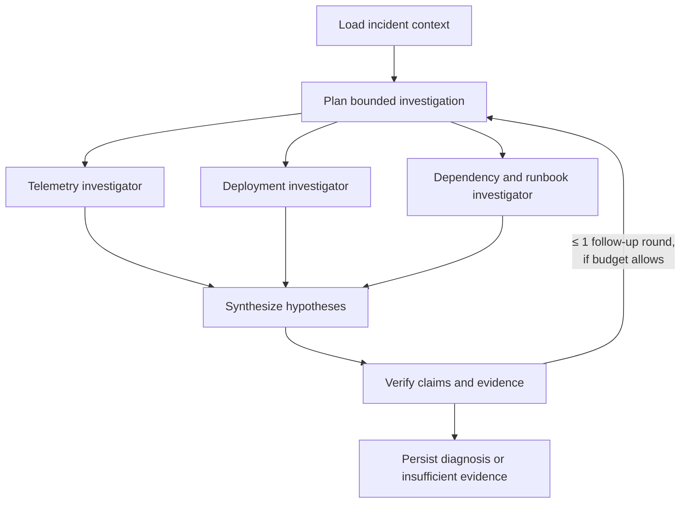

# Agents and workflow

> Status: built on the fake provider. The single-agent slice (Phases 6–7, workflow `v2`) and the multi-agent workflow `v3` (Phase 9: roles and handoffs, parallel branches with budget shares, contradictions, one bounded follow-up round, recovery and prompt-injection checks) are in place. No paid model has run either workflow, so nothing here measures diagnostic quality; P10 compares them. The source is [SignalOps_Implementation_Plan.md](SignalOps_Implementation_Plan.md) §7–8.

## Principles

- **A single agent comes first.** Start with one tool-using agent on the fake provider. Add specialists, synthesis, and verification only after the single-agent slice works end to end.
- **The workflow is an explicit Python state machine.** It is not a generic agent framework. Every node has typed input and output contracts and a persisted checkpoint.
- **Agents are logical roles** inside the investigation worker, not separate services.
- **Everything is bounded:** steps, output tokens, concurrency, per-call timeouts, an overall deadline, and money.
- **Evidence is untrusted data.** Log lines and runbooks cannot grant tools or widen scope. Authorization lives in code.

## Workflow



- An investigation runs **at most 3 concurrent specialist branches**, as one `Parallel` stage. Specialists never spawn agents recursively. A worker process runs `SIGNALOPS_WORKER_JOB_CONCURRENCY` jobs and at most `SIGNALOPS_AGENT_GLOBAL_BRANCHES` branches across them; a branch waits for a slot ([ADR-032](decisions.md#adr-032-specialists-run-as-one-parallel-stage-under-process-wide-slots-and-durable-budget-shares)).
- The verifier may request **one** bounded follow-up round, and only within the remaining budget and deadline ([ADR-033](decisions.md#adr-033-code-records-contradictions-and-the-verifier-gets-at-most-one-follow-up-round)). It is offered only when one more specialist call and one more verification call fit at their maximum; the `follow_up` node runs the requested specialist once with its question, and `reverify` gives the final verdict and can never ask again.
- Contradictions stay visible: code records every pair of specialists blaming different services, and the diagnosis lists them with the synthesizer's, diagnosed or not.
- Downstream capacity for synthesis and verification is reserved up front, so specialists cannot exhaust the budget first: the plan holds back one call of each, and each specialist's calls must fit an equal share of the rest. A specialist out of its share reports it and the investigation goes on.

The engine exists (P06-T03, ADR-022). Workflow `v3` ([ADR-031](decisions.md#adr-031-workflow-v3-splits-the-agent-into-roles-with-code-built-briefs-and-code-checked-handoffs)) is the default for new investigations: `load_context`, `plan`, `telemetry`, `deployment`, `dependency`, `synthesize`, `verify`, `follow_up`, `reverify`, `conclude`. Workflow `v2` runs three nodes ([ADR-028](decisions.md#adr-028-workflow-v2-is-one-bounded-agent-whose-answer-is-a-tool-call)): `load_context` builds the incident brief, `investigate` runs one tool-using agent, and `conclude` turns its findings into the `Diagnosis`. `v1`, which always abstains, stays for rows that use it. Phase 9 adds the branches above.

The agent loop is bounded by `max_steps` minus the node count, 5 tool calls per turn, 10 per step, `SIGNALOPS_MODEL_MAX_OUTPUT_TOKENS` per reply, and `SIGNALOPS_AGENT_MAX_REPAIRS` rejected replies. It ends by calling `submit_findings`. Exhausting a bound, or a model refusal, abstains. Running out of budget ends `budget_exceeded`. In fake mode a fixed rule plays the loop over real evidence, which proves the plumbing, not diagnostic quality.

## Roles

| Role | Step | Prompt | Tools | Receives | Output |
| --- | --- | --- | --- | --- | --- |
| Coordinator (code) | `load_context`, `plan` | none | none | Incident, its services, the investigation's limits | `InvestigationPlan`: each branch's brief, turns, and budget share |
| Telemetry investigator | `telemetry` | `telemetry-v1` | `query_logs`, `get_trace_summary` | Incident facts, services, detector-cited signals | `SpecialistFindings` |
| Deployment investigator | `deployment` | `deployment-v1` | `get_deployments`, `query_logs` | Incident facts, services, the incident's services | `SpecialistFindings` |
| Dependency and runbook investigator | `dependency` | `dependency-v1` | `get_service_dependencies`, `retrieve_runbooks` | Incident facts, services, the incident's services | `SpecialistFindings` |
| Synthesizer | `synthesize` | `synthesizer-v1` | none | Specialists' reports and how each branch ended | `SynthesisOutput`: ranked hypotheses, contradictions |
| Verifier | `verify` | `verifier-v2` | none | The synthesis and the leading citations as stored, redacted | `VerificationOutput`: verdict, one check per citation |

Each role receives only the context it needs, built by code. Prompts carry versions, which every `llm_calls` row records, and outputs have schemas in `contracts/schemas/workflow/`. A finding carries a confidence and a required uncertainty; every stored output carries `Provenance` (role, prompt version, model, turns, tool call keys, signals read, how the loop ended).

Handoffs are checked in code, and a refusal goes back to the model as a repair: a specialist may cite only what its own tool results returned, the synthesis only what specialists cited, and the verifier must judge exactly the leading citations. `conclude` keeps only the citations the verifier accepted. Any other tool name, including another role's tool, is refused.

## Tools

All tools are **read-only** and typed. Each call enforces workspace scope, replay scope, the incident evidence cutoff, a bounded time range, row and byte caps, a timeout, and redaction.

| Tool | Reads |
| --- | --- |
| `query_logs` | Normalized log signals for services and windows |
| `get_trace_summary` | Trace summaries by trace ID or service |
| `get_deployments` | Deployments before the cutoff |
| `get_service_dependencies` | Bounded graph neighborhood (≤ 3 hops) as of incident time |
| `retrieve_runbooks` | Versioned runbook content with provenance |

Implemented in `agents/tools.py` ([ADR-027](decisions.md#adr-027-tools-take-typed-arguments-and-code-alone-supplies-scope-and-cutoff)): at most 6 hours, 50 rows, and 16 KiB per call. A signal is visible only when it both happened and arrived by the cutoff, so a late arrival stays future evidence. A failed call returns a `ToolFailure` to the agent. `signalops seed` adds two synthetic demo runbooks.

No tool exposes SQL, shell access, future evidence, or evaluation labels.

**Prompt injection (P09-T05).** `fixtures/adversarial/v1/injections.json` plants instructions in logs and a runbook: run a shell, restart a service, read another workspace, cite a planted signal from another run, self-approve a rollback, and leak secrets. `tests/integration/test_prompt_injection.py` lets a compromised model obey every one. Invented tools and another role's tools return "There is no such tool."; extra scope arguments fail validation; an outside service and a window past the cutoff are out of scope; the planted citation is refused as unread; `requires_approval: false` fails validation; no secret reaches any request, step, diagnosis, tool row, or log, because tool results and the verifier's packet are redacted before a model sees them; and nothing outside the investigation changes. Evidence that only asserts a cause, and an incident with no evidence, end in abstention. Redaction is a pattern match on sensitive `key=value` pairs and bearer tokens; a secret in another shape would pass through. Read-only results are cached in Redis for `SIGNALOPS_TOOL_CACHE_SECONDS` under keys that include workspace, replay scope, cutoff, and data version, and a stored value must prove the same identity to be read.

## LLM gateway

Every model call goes through `backend/signalops/gateway`, which centralizes:

- Provider routing, timeouts, and retry policy (permanent vs retryable errors, capped backoff).
- Provider rate and token limits (atomic in Redis; calls pause if Redis is unavailable).
- Structured output validation and bounded repair.
- Prompt and workflow versions, provider request IDs, usage attribution, and sanitized logging.

A **fake provider** with deterministic fixtures is the default for development and CI. It can simulate success, timeout, throttling, invalid output, and insufficient evidence without network access. Provider credentials stay on the server.

### Budget reservation

1. Before each call, atomically reserve a conservative upper cost bound against `investigations.budget_microusd` in PostgreSQL. In-flight parallel calls count toward the reservation.
2. On completion, reconcile to actual usage and record whether the cost is *actual*, *estimated*, or *unknown*.
3. An ambiguous timeout may already have cost money. Record an unknown outcome and **keep the reservation**. A retry is a new, separately reserved, possibly billable call.
4. Running out of budget ends the investigation as `budget_exceeded`.

Redis rate limits never replace the durable PostgreSQL budget ledger. See [ADR-026](decisions.md#adr-026-the-gateway-reserves-each-calls-maximum-and-redis-only-meters-the-provider).

## Diagnosis contract

Implemented as `Diagnosis` in `backend/signalops/contracts/diagnosis.py` (P02-T04). Valid examples: [`diagnosed.json`](../fixtures/contracts/v1/diagnoses/diagnosed.json) and [`insufficient_evidence.json`](../fixtures/contracts/v1/diagnoses/insufficient_evidence.json).

```json
{
  "status": "diagnosed",
  "summary": "Checkout failures correlate with the payment deployment that halved the bank-gateway connection pool.",
  "root_cause": {
    "service_id": "5f3e2d1c-0b9a-4876-9543-210fedcba987",
    "service_name": "payment",
    "failure_type": "connection_pool_exhaustion",
    "confidence": 0.82,
    "evidence_signal_ids": [
      "9c8b7a69-5848-4372-a615-0f9e8d7c6b5a",
      "1d2e3f40-5162-4738-89ab-cdef01234567"
    ]
  },
  "alternatives": [
    {"hypothesis": "Database outage", "assessment": "Not supported: no database errors appear in the evidence window."}
  ],
  "suggested_actions": [
    {"action": "Review pool settings and consider reverting the payment deployment", "requires_approval": true}
  ],
  "limitations": ["No database connection metrics were available"],
  "missing_evidence": [],
  "workflow_version": "v1"
}
```

The contract rejects unknown fields (no free-form reasoning field), caps list lengths and text sizes, requires 1–50 unique evidence UUIDs for a diagnosed result, and requires `missing_evidence` for an abstention.

Validation checks ([ADR-029](decisions.md#adr-029-citations-are-verified-in-postgresql-and-cached-reads-prove-their-identity)), on submission and again in `conclude`, that:

- Every cited ID is a UUID that exists within scope and was known by the cutoff.
- `confidence` lies in [0, 1] and is described as a model assessment until evaluation calibrates it.
- Unsupported conclusions come back as `status: "insufficient_evidence"` with a null `root_cause` and the missing evidence listed.
- Suggested actions always require human approval. SignalOps never remediates on its own.

## Durable execution

- A worker claims a job with `SELECT … FOR UPDATE SKIP LOCKED`, sets a short lease, increments `lease_generation`, and **commits before any external call**. It heartbeats while running.
- Each checkpoint and completion write checks `lease_owner` and `lease_generation`, so an expired worker cannot overwrite newer progress.
- Completed steps (`UNIQUE(investigation_id, step_key)`) are reused after a restart once their schema and version are validated. Only unfinished nodes run again.
- Cancellation and deadline are checked before every node, before each model call, and on every heartbeat, which interrupts a running node ([ADR-023](decisions.md#adr-023-cancellation-is-a-durable-request-workers-end-the-job)).
- The system guarantees **checkpoint reuse**, not exactly-once external model execution.
- A workflow ends in a `Diagnosis` node. One fenced transaction ends the job and investigation with it, so a replay reaches the stored outcome ([ADR-024](decisions.md#adr-024-one-transaction-ends-the-job-and-the-investigation)).
- Each step transition and the ending write a `progress_events` row in the same transaction. Rows hold identifiers and categories. Findings stay in `agent_steps.output` and `investigations.diagnosis`.

See [reliability.md](reliability.md) for the full set of recovery guarantees and tests.
