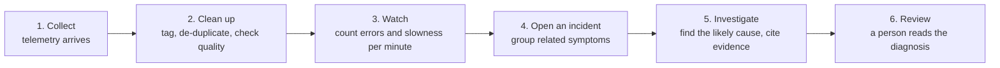

# How SignalOps works: one incident from start to finish

This guide follows one real incident through SignalOps, from the first sign of trouble to a written diagnosis. It is meant for readers who are not engineers. It explains what each step does and what the incident page shows, using the *High error rate on payment* incident recorded on the local demo stack on 9 November 2026.

Times are UTC, as shown in the UI for this run.

## The short version

Software systems constantly produce records about themselves: what each request did, how long it took, and what went wrong. Most of this is routine noise. SignalOps reads that stream, notices when something is really going wrong, groups the related symptoms into one **incident**, and runs an automated **investigation** that names the most likely cause and points to the exact records that support it.

In the example, about one and a half minutes passed between the minute in which trouble started and the opened incident. The investigation finished 16 seconds later.

## The example system

The demo simulates the checkout of an online shop with five services. A **service** is one independently running piece of the software:

| Service | What it does |
| --- | --- |
| `checkout` | Handles the customer pressing "Buy" |
| `inventory` | Checks that the items are in stock |
| `orders-db` | The database that stores orders |
| `payment` | Charges the customer |
| `bank-gateway` | The connection to the bank, used by `payment` |

For each purchase, `checkout` calls `inventory`, then `orders-db`, then `payment`. `payment` in turn calls `bank-gateway`. `payment` waits up to 2 seconds for the bank's answer and gives up after that.

For this run we injected a fault: partway through a five-minute stream of traffic, `bank-gateway` became slow. Nothing in the data said which service was at fault. SignalOps had to work that out.

## Step by step

### 1. Collect

Each service sends three kinds of records, called **telemetry**:

- **Traces**: one summary per request, with how long it took and whether it failed. For example, *"POST /checkout error in 169 ms (2/14 spans failed)"*.
- **Logs**: messages the software writes, each with a severity. For example, *"upstream bank-gateway call timed out after 2000 ms"* (severity: error).
- **Deployments**: notes that a new version of a service was released.

SignalOps confirms a record as received only after it is safely stored in its message queue, so a record is never reported as received and then lost.

### 2. Clean up

Each record is matched to the service it came from. If the same record arrives twice, it is stored once. Records with problems, such as a missing timestamp or arriving very late, are flagged rather than dropped. The incident page later shows a quality summary for each data source.

### 3. Watch

SignalOps cuts time into one-minute **windows** (17:02:00 to 17:03:00, 17:03:00 to 17:04:00, and so on). For each service and window it counts how many requests and log messages there were, how many failed, and how long the requests took.

When a window ends, SignalOps waits 30 more seconds for stragglers, then checks the numbers against three **rules**:

| Rule | In plain words | Fires when | Needs at least |
| --- | --- | --- | --- |
| `trace_error_rate` | Share of requests that failed | 20% or more of requests failed | 15 requests |
| `trace_latency_p95` | How slow the slowest requests were | The slowest 5% of requests took more than 1 second | 20 requests |
| `log_error_rate` | Share of log messages that report an error | 50% or more of log messages are errors | 10 log messages |

The minimum counts prevent false alarms: one failed request in an otherwise empty minute is not a "100% error rate".

When a rule's limit is crossed, the rule **fires**. A rule that fired for a service stays quiet for that service for the next 5 minutes, so one problem does not produce a flood of alerts.

### 4. Open an incident

In the example, the window 17:02:00 to 17:03:00 closed, the 30-second grace period passed, and at **17:03:31** seven rules fired at once across three services.

SignalOps does not open seven incidents. Firings in the same environment that happen within 10 minutes of each other are grouped into **one** incident, because they are most likely symptoms of a single problem. The incident:

- is titled after the first firing it recorded, here a high error rate on `payment`: *High error rate on payment (demo)*. The title names where the problem was first noticed, not its cause.
- takes the highest severity among its firings. A failed-request rate is a **high** severity rule, so the incident is *high*.
- lists `payment`, `checkout`, and `bank-gateway` as affected services.
- attaches the records that broke the rules as **evidence**: 81 records for this incident.

The fault kept going for a few more minutes. Those later windows did not create new firings during the 5-minute quiet period, but they moved the incident's "last seen" time forward to 17:05.

### 5. Investigate

Opening the incident automatically requests an **investigation**, as part of the same step that saves the incident, so the request cannot be lost. A separate worker process picks it up and runs a fixed sequence of steps:

1. A **coordinator** plans the investigation.
2. Three **specialists** work in parallel, each looking at one angle:
   - *telemetry*: which services are failing or slow, and in what order;
   - *deployment*: whether a recent release lines up with the trouble;
   - *dependency*: which service calls which, and where failing calls end.
3. A **synthesizer** combines their findings into one diagnosis.
4. A **verifier** checks that every claim points to real evidence.

Guardrails:

- The specialists can only **read** data. They cannot change anything in the systems they look at.
- They only see evidence recorded **before** the investigation started (here, 17:03:31). A later record cannot influence the diagnosis.
- Every cited record is checked to exist. A claim without support is not stored. When the evidence is too thin, the investigation says *insufficient evidence* rather than guessing.
- Each investigation has a spending limit (3 USD here), a step limit (40), and a deadline (10 minutes). Cost is reserved before each AI call, so the limit holds even when calls run in parallel.

**Result for the example** (requested 17:03:31, finished 17:03:47):

| | |
| --- | --- |
| Likely cause | `bank-gateway` |
| Type of failure | Downstream timeout: a service waited too long for another service it depends on |
| Confidence | 0.7 (on a scale of 0 to 1) |
| Summary | "Failing calls end at this service, and its evidence shows the fault." |
| Supporting evidence | 10 cited records |
| Alternative considered | A new version of `inventory` was released shortly before the incident; the deployment specialist suggested it as the cause |
| Disagreement recorded | The telemetry and deployment specialists pointed to different services; the diagnosis records this openly instead of hiding it |
| Estimated cost | 0.13 USD of the 3 USD limit |

This matches the injected fault. `payment` and `checkout` reported the errors, but they were victims: `bank-gateway` was slow, `payment` gave up waiting after 2 seconds, and `checkout` failed because `payment` failed. The `inventory` release was a coincidence, and the diagnosis kept it as an alternative instead of ignoring it.

### 6. Review

The incident page brings everything together for a person to review:

- the **rule firings** (explained below);
- the **affected services**;
- the **evidence timeline**: the cited records in time order, each expandable to its full details;
- the **data quality** of each source;
- the **dependency graph**: which services were calling which at the time of the incident;
- the **investigation panel**: live progress while it runs, then the diagnosis with each claim's evidence.

*Start investigation* runs another investigation at any time. For this incident, two more were started by hand at 17:33 and 17:34 and reached the same result.

SignalOps diagnoses. It does not fix anything automatically; acting on the diagnosis is the reader's decision.

## Reading the Rule firings table

The table lists every rule that fired for this incident. These are the seven rows for the example:

| Window | Service | Rule | Observed | Threshold | Samples |
| --- | --- | --- | --- | --- | --- |
| Nov 9, 2026, 5:02:00 PM | payment | trace_latency_p95 | 2500.00 | 1000.00 | 23 |
| Nov 9, 2026, 5:02:00 PM | bank-gateway | trace_latency_p95 | 5000.00 | 1000.00 | 23 |
| Nov 9, 2026, 5:02:00 PM | checkout | trace_error_rate | 0.61 | 0.20 | 23 |
| Nov 9, 2026, 5:02:00 PM | payment | log_error_rate | 0.76 | 0.50 | 17 |
| Nov 9, 2026, 5:02:00 PM | payment | trace_error_rate | 0.57 | 0.20 | 23 |
| Nov 9, 2026, 5:02:00 PM | checkout | log_error_rate | 0.72 | 0.50 | 18 |
| Nov 9, 2026, 5:02:00 PM | checkout | trace_latency_p95 | 2500.00 | 1000.00 | 23 |

### The columns

- **Window**: the start of the one-minute period that was measured. *5:02:00 PM* means the minute from 17:02:00 to 17:03:00. All seven rows come from the same minute.
- **Service**: the service whose numbers broke the rule.
- **Rule**: which of the three rules fired (see [step 3](#3-watch)).
- **Observed**: what was measured in that minute. The unit depends on the rule:
  - For error-rate rules it is a fraction: **0.76 means 76%**.
  - For the latency rule it is milliseconds, rounded **up** to the next step of a fixed scale (…, 500, 1000, 2500, 5000, 10000, …). **2500.00** means the slowest 5% of requests took between 1 and 2.5 seconds; **5000.00** means between 2.5 and 5 seconds. SignalOps stores durations in these ranges rather than exact values, which keeps counting fast and the limit check exact.
- **Threshold**: the rule's limit. The rule fired because Observed was at or above it for error rates, or above it for latency.
- **Samples**: how many records were counted for that service in that minute: requests for the `trace_` rules, log messages for `log_error_rate`. That is why log rows show 17 or 18 while request rows show 23. Every row is above its rule's minimum, so the numbers are meaningful.

### What these rows say together

| Service | What the rows show | Plain reading |
| --- | --- | --- |
| `bank-gateway` | Slow (5000), but **no** error-rate rows | It was not failing, it was slow: its slowest requests took 2.5 to 5 seconds, five times the 1-second limit |
| `payment` | Slow (2500), 57% of requests failed, 76% of log messages were errors | It waited on the bank, gave up after 2 seconds, and reported the failure. Its logs say so: *"upstream bank-gateway call timed out after 2000 ms"* |
| `checkout` | Slow (2500), 61% of requests failed, 72% of log messages were errors | It failed because `payment` failed underneath it |

The pattern of slowness at the bottom of the chain and errors above it is the typical signature of a downstream timeout. The table alone shows **symptoms**. The investigation turns them into a **cause**, `bank-gateway`, and backs it with cited records.

### Things that can be surprising

- **The incident title names `payment`, but the cause is `bank-gateway`.** The title records where the problem was first noticed. The cause is in the diagnosis.
- **`inventory` and `orders-db` are missing from the table.** Their numbers stayed within the limits.
- **The fault lasted several minutes but every row is from one minute.** Each rule fires at most once per service per 5 minutes. Later bad minutes extended the incident without adding rows.
- **The table can hold firings from different minutes.** If another service crosses a limit within 10 minutes, it joins the same incident and its row shows its own window.

## Caveats for this example

- **The data is synthetic.** The traffic and the fault were generated by the demo, not observed on a real system.
- **The AI is simulated.** This run used SignalOps's built-in fake model, which answers by fixed rules. It shows that the process works end to end (guardrails, limits, evidence checks, recovery), but it says nothing about how well a real AI model would diagnose real incidents. The diagnosis lists this under its limitations ("Produced by a deterministic fake role"). The cost shown is an estimate; nothing was billed.

For the full technical picture, see the [demonstration](demo.md), [architecture](architecture.md), and [agents and workflow](agents-and-workflow.md).
