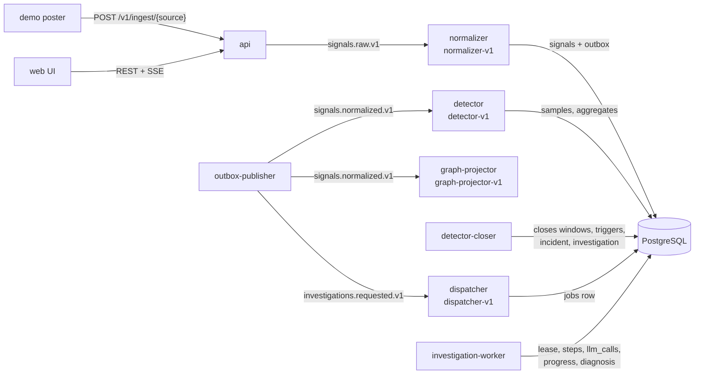
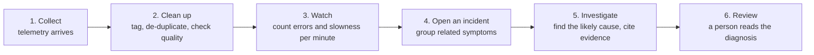

# How SignalOps works: one incident from start to finish

**Part 1: For technical readers**
- [Pipeline at a glance](#pipeline-at-a-glance)
- [The example run](#the-example-run)
- [Ingestion](#ingestion)
- [Normalization](#normalization)
- [Detection and window closure](#detection-and-window-closure)
- [Incident correlation](#incident-correlation)
- [Investigation dispatch and execution](#investigation-dispatch-and-execution)
- [Operator surface](#operator-surface)
- [Rule firings: data and semantics](#rule-firings-data-and-semantics)
- [Limits of this example](#limits-of-this-example)

**Part 2: For non-technical readers**
- [The short version](#the-short-version)
- [The example system](#the-example-system)
- [Step by step](#step-by-step)
- [Reading the Rule firings table](#reading-the-rule-firings-table)
- [Caveats for this example](#caveats-for-this-example)

Both parts follow the same incident, *High error rate on payment (demo)* (`59647158-2e06-4c30-8b77-5bafb9878dd5`), recorded on the local Compose stack on 9 November 2026. Times are UTC.

## Part 1: For technical readers

This part traces the incident through processes, topics, and tables. The design behind each step is in [architecture.md](architecture.md), [events.md](events.md), [agents-and-workflow.md](agents-and-workflow.md), and [reliability.md](reliability.md).

### Pipeline at a glance



PostgreSQL holds evidence, incidents, jobs, checkpoints, budgets, and progress. Kafka carries signals and domain events. Every database change that emits an event writes an outbox row in the same transaction; `outbox-publisher` sends it and marks it published only after the broker acknowledges. Consumers record a `consumer_receipts` row and commit offsets only after the transaction commits, so redelivery is harmless.

### The example run

`demo-post downstream-timeout --realtime --duration-s 300` posted five minutes of traces, logs, and one deployment for `checkout`, `inventory`, `orders-db`, `payment`, and `bank-gateway`, with background noise. The call graph per checkout is `checkout → inventory → orders-db → payment → bank-gateway`; `payment` times out bank calls at 2000 ms. Between 40% and 80% of the run, most `bank-gateway` calls outlast that timeout. The records carry no scenario label.

| Time | Event | Where it is recorded |
| --- | --- | --- |
| 17:02:00–17:03:00 | The first full fault window | `signal_aggregates` |
| 17:03:30 | Window deadline (end + 30 s lateness) | |
| 17:03:31.010 | 7 rule triggers inserted | `detection_triggers.triggered_at` |
| 17:03:31.016 | Incident created | `incidents.detected_at` |
| 17:03:31.023 | Investigation created; evidence cutoff set | `investigations.created_at`, `evidence_cutoff_at` |
| 17:03:31.247 | Job created by the dispatcher | `jobs.created_at` |
| 17:03:32.145 | First workflow step started | `agent_steps.started_at` |
| 17:03:47.463 | Investigation completed | `investigations.completed_at` |
| 17:05:00 | Incident `last_seen_at` after later breaching windows | `incidents.last_seen_at` |

### Ingestion

The poster sends batches to `POST /v1/ingest/{source}` with a per-source ingest token. Each record carries a stable `source_event_id`. The API produces `signal.raw` envelopes to `signals.raw.v1` (key `{source_id}:{service_hint}`, `acks=all`) and reports each record `accepted` only after the broker acknowledges it. A broker outage reports records as failed, never accepted.

### Normalization

`normalizer` (group `normalizer-v1`) resolves the service hint to a `services` row, sets data-quality flags (for example `late_arrival` past 900 s), and stores the signal. The signal row, the consumer receipt, and an outbox row for `signal.normalized` commit in one transaction, then the offset is committed. A redelivered or re-posted record resolves to the same stable signal ID and produces no second row. `outbox-publisher` publishes to `signals.normalized.v1` keyed `{workspace_id}:{service_id}`, so one service's signals stay ordered in one partition.

`graph-projector` consumes the same topic in its own group and maintains the temporal service graph (`graph_nodes`, `graph_edges` with validity ranges) that the dependency specialist and the UI read.

### Detection and window closure

`detector` (group `detector-v1`) turns each accepted trace or log into a `detection_samples` row and adds it to the service's `signal_aggregates` window. Windows are epoch-aligned and 60 s long (`SIGNALOPS_DETECTION_WINDOW_SECONDS`). Trace samples carry an error bit (`status = error`) and a duration counted in a fixed histogram; log samples carry an error bit (severity `error` or `critical`).

Rules run once, at closure. In live mode `detector-closer` closes a window when the wall clock passes `window_end + 30 s` (`SIGNALOPS_DETECTION_ALLOWED_LATENESS_SECONDS`). A sample arriving after the deadline is flagged `late` and stays queryable evidence, but it cannot change the counts or raise a historical trigger. That is why a backfilled run without `--realtime` opens no incident.

Default rules (`backend/signalops/detection/rules.py`):

| Rule | Metric | Fires when | `min_samples` | Cooldown | Severity |
| --- | --- | --- | --- | --- | --- |
| `trace_error_rate` v2 | trace | error rate ≥ 0.2 | 15 | 300 s | high |
| `trace_latency_p95` v2 | trace | p95 > 1000 ms | 20 | 300 s | medium |
| `log_error_rate` v2 | log | error rate ≥ 0.5 | 10 | 300 s | medium |

A firing inserts a `detection_triggers` row, unique on `(service_id, replay_scope, rule_id, window_start)`. Cooldown is in event time: a rule that fired for a service does not fire again for windows starting within 300 s. Breaches during cooldown still extend the incident, but create no trigger.

### Incident correlation

Every breach goes through `record_breach` (`backend/signalops/detection/incidents.py`) in the closing transaction:

1. Look for an incident with fingerprint `env:{environment}` (here `env:demo`) seen within `SIGNALOPS_INCIDENT_CORRELATION_GAP_SECONDS` (600).
2. If none exists, create one titled `{RULE_TITLES[kind]} on {service} ({environment})` from the first breach processed. Here that was an error-rate breach on `payment`, hence *High error rate on payment (demo)*. Otherwise extend the existing incident's seen range and raise its severity to the highest rule severity (`high`, from `trace_error_rate`).
3. Add the service to `incident_services` (`payment`, `checkout`, `bank-gateway`, all `primary`).
4. Attach up to 20 breaching samples per trigger to `incident_signals` with relevance 1.0, capped per incident. Error-rate rules attach error samples; the latency rule attaches samples slower than the threshold. Samples cited by several triggers are stored once: this incident cites 81 signals.
5. Write an `incident.changed` outbox row (`incidents.changed.v1`), with an event ID derived from incident ID and version.
6. For a new live incident, also create the `investigations` row with `request_key = detector:{incident_id}` and an `investigation.requested` outbox row (`SIGNALOPS_INVESTIGATION_AUTO_REQUEST`, on by default).

The incident and its investigation request commit together, so neither can exist without the other.

Resolution needs evidence: every service must have a healthy window (at least `min_samples`, no breach) ending at least 300 s (`SIGNALOPS_INCIDENT_RECOVERY_SECONDS`) after `last_seen_at`. The demo traffic stopped at the end of the run, so this incident stays `open` until more traffic arrives or an operator resolves it with `PATCH /v1/incidents/{id}`.

### Investigation dispatch and execution

`dispatcher` (group `dispatcher-v1`) consumes `investigations.requested.v1` and inserts a `jobs` row, unique per investigation. `investigation-worker` claims it with `SELECT … FOR UPDATE SKIP LOCKED`, a 30 s lease (`SIGNALOPS_JOB_LEASE_SECONDS`), and an incremented `lease_generation`, and commits before any external call. Every checkpoint and the final write check owner and generation, so a stale worker cannot overwrite newer progress.

Investigation limits, set at creation: evidence cutoff 17:03:31.023, budget 3,000,000 µUSD, 40 steps, deadline 17:13:31. Tools may read only signals that both happened and arrived before the cutoff, within the incident's workspace and replay scope.

Workflow `v3`, as recorded in `agent_steps` for investigation `5f717c30-961b-45ee-8313-35e65e0d8222`:

| Step | Role | Started | Duration |
| --- | --- | --- | --- |
| `load_context` | coordinator (code) | 17:03:32.145 | 13 ms |
| `plan` | coordinator (code) | 17:03:32.164 | 7 ms |
| `telemetry` | telemetry investigator | 17:03:32.178 | 9.2 s |
| `deployment` | deployment investigator | 17:03:32.185 | 6.1 s |
| `dependency` | dependency investigator | 17:03:32.193 | 6.1 s |
| `synthesize` | synthesizer | 17:03:41.343 | 3.0 s |
| `verify` | verifier | 17:03:44.382 | 3.0 s |
| `follow_up` | coordinator | 17:03:47.420 | 8 ms |
| `reverify` | verifier | 17:03:47.436 | 6 ms |
| `conclude` | synthesizer | 17:03:47.449 | 7 ms |

The three specialists ran as one parallel stage. `follow_up` and `reverify` made no model calls because the verifier requested no follow-up round. Each step ran once (attempt 1, generation 1); the job ended `succeeded` after one attempt.

Gateway accounting (`llm_calls`, `tool_calls`, `progress_events`):

| | Value |
| --- | --- |
| Model calls | 9, provider `fake`, model `fake-1` |
| Tokens | 25,961 input, 1,546 output |
| Cost | 134,764 µUSD, `cost_basis = estimated` from the price table; nothing billed |
| Tool calls | 8, read-only, bounded to 6 h, 50 rows, and 16 KiB per call |
| Progress events | 21 |

Each model call reserved its cost in PostgreSQL before running and settled afterwards. The step durations are about 3 s per model call because `SIGNALOPS_FAKE_MODEL_DELAY_SECONDS=3` was set for the crash exercise.

The stored `investigations.diagnosis` (status `completed` requires `diagnosis.status = "diagnosed"` by check constraint):

```json
{
  "status": "diagnosed",
  "workflow_version": "v3",
  "summary": "Failing calls end at this service, and its evidence shows the fault.",
  "root_cause": {
    "service_name": "bank-gateway",
    "failure_type": "downstream_timeout",
    "confidence": 0.7,
    "evidence_signal_ids": ["874d209f-…", "… 10 signals in total"]
  },
  "alternatives": [
    {
      "hypothesis": "inventory: deployment_regression",
      "assessment": "Revision inventory-2026.10.16-2 of this service was deployed shortly before the incident window."
    }
  ],
  "contradictions": [
    {
      "roles": ["telemetry_investigator", "deployment_investigator"],
      "description": "telemetry investigator points to one service and deployment investigator to another.",
      "evidence_signal_ids": ["874d209f-…", "… 4 signals"]
    }
  ],
  "missing_evidence": [],
  "suggested_actions": [],
  "limitations": ["Produced by a deterministic fake role."]
}
```

Every cited signal was checked in PostgreSQL to exist in scope and before the cutoff; `conclude` keeps only the citations the verifier accepted. Contradictions are recorded by code whenever two specialists blame different services.

Two operator-requested investigations followed (`POST /v1/incidents/{id}/investigations` with an `Idempotency-Key`, request keys `operator:…`) at 17:33:32 and 17:34:20. Both completed with the same diagnosis at an estimated 136,252 µUSD each.

### Operator surface

| UI section | API | Source |
| --- | --- | --- |
| Incident header, services, rule firings | `GET /v1/incidents/{id}` | `incidents`, `incident_services`, `detection_triggers` |
| Evidence timeline | `GET /v1/incidents/{id}/evidence` | `incident_signals` joined to `signals`, oldest first |
| Dependency graph | `GET /v1/services/{id}/graph?as_of=…` | `DEPENDS_ON` edges valid at incident time, up to 3 hops, cycle-safe |
| Investigation list | `GET /v1/incidents/{id}/investigations` | `investigations` |
| Live progress | `GET /v1/investigations/{id}/events` (SSE) | `progress_events`; reconnect resumes from `Last-Event-ID`, Redis only wakes listeners |
| Diagnosis, usage | `GET /v1/investigations/{id}` | `investigations.diagnosis`, `llm_calls` |
| End-to-end trace | `GET /v1/investigations/{id}/trace` | jobs, attempts, steps, calls |

### Rule firings: data and semantics

The table is `detection_triggers` for the incident, returned by `GET /v1/incidents/{id}` (oldest first, up to 200):

| UI column | Column | Meaning |
| --- | --- | --- |
| Window | `window_start` | Start of the 60 s window, shown in browser time; `window_end` is 60 s later |
| Service | `service_id` → `services.name` | Series the rule was evaluated on |
| Rule | `rule_id` (`rule_version` stored alongside) | Rule that breached |
| Observed | `observed` | Error rate in [0, 1], or the latency quantile in ms |
| Threshold | `threshold` | Rule threshold at evaluation time |
| Samples | `sample_count` | Samples in the window for that metric (traces or logs) |
| (not shown) | `error_count` | Error samples in the window |

For this incident:

| Service | Rule | Observed | Threshold | Samples | Errors |
| --- | --- | --- | --- | --- | --- |
| payment | `log_error_rate` | 0.7647 (13/17) | 0.5 | 17 | 13 |
| checkout | `log_error_rate` | 0.7222 (13/18) | 0.5 | 18 | 13 |
| bank-gateway | `trace_latency_p95` | 5000 | 1000 | 23 | 0 |
| payment | `trace_error_rate` | 0.5652 (13/23) | 0.2 | 23 | 13 |
| payment | `trace_latency_p95` | 2500 | 1000 | 23 | 13 |
| checkout | `trace_error_rate` | 0.6087 (14/23) | 0.2 | 23 | 14 |
| checkout | `trace_latency_p95` | 2500 | 1000 | 23 | 14 |

All seven rows share `window_start = 17:02:00` and `triggered_at = 17:03:31.010`, so the UI's oldest-first order among them is not meaningful.

Reading the values:

- **Latency is a histogram bound, not an exact quantile.** Durations go into fixed buckets (…, 500, 1000, 2500, 5000, 10000, … ms). The reported p95 is the upper bound of the bucket that reaches the 95th percentile, an overestimate by at most one bucket: 2500 means p95 ∈ (1000, 2500], and 5000 means p95 ∈ (2500, 5000]. Latency thresholds must be bucket bounds, so the breach test is exact: p95 > 1000 exactly when fewer than ⌈0.95·n⌉ samples are at or below 1000 ms.
- **Error rates are plain ratios**, compared with `≥`; latency is compared with `>`.
- **Samples are per metric.** Trace rows count trace summaries (23); log rows count log records (17 and 18). Each row meets its rule's `min_samples`.
- **The pattern points downstream.** `bank-gateway` is slow with zero errors. `payment` and `checkout` are slow and erroring, their p95 capped near `payment`'s 2000 ms timeout (bucket 2500). That is the signature of a downstream timeout, which the investigation then confirms with citations.
- **One window per series.** The fault continued to about 17:05, but the 300 s cooldown suppressed further triggers; later breaching windows only moved `last_seen_at`. A breach on another service within the 600 s gap would add a row with its own window.

To read the same rows directly:

```sql
SELECT s.name, t.rule_id, t.rule_version, t.window_start, t.observed, t.threshold,
       t.sample_count, t.error_count, t.triggered_at
FROM detection_triggers t JOIN services s ON s.id = t.service_id
WHERE t.incident_id = '59647158-2e06-4c30-8b77-5bafb9878dd5'
ORDER BY t.triggered_at;
```

### Limits of this example

- Synthetic telemetry from the demo generator; one single-node Compose host.
- Fake model provider: the diagnosis comes from fixed rules over real evidence. It shows the runtime (leases, budgets, checkpoints, citation checks) and nothing about diagnostic quality. See [evaluation.md](evaluation.md).
- Costs are estimates from token counts and the configured price table.

## Part 2: For non-technical readers

This guide follows one real incident through SignalOps, from the first sign of trouble to a written diagnosis. It is meant for readers who are not engineers. It explains what each step does and what the incident page shows, using the *High error rate on payment* incident recorded on the local demo stack on 9 November 2026.

Times are UTC, as shown in the UI for this run.

### The short version

Software systems constantly produce records about themselves: what each request did, how long it took, and what went wrong. Most of this is routine noise. SignalOps reads that stream, notices when something is really going wrong, groups the related symptoms into one **incident**, and runs an automated **investigation** that names the most likely cause and points to the exact records that support it.



In the example, about one and a half minutes passed between the minute in which trouble started and the opened incident. The investigation finished 16 seconds later.

### The example system

The demo simulates the checkout of an online shop with five services. A **service** is one independently running piece of the software:

| Service | What it does |
| --- | --- |
| `checkout` | Handles the customer pressing "Buy" |
| `inventory` | Checks that the items are in stock |
| `orders-db` | The database that stores orders |
| `payment` | Charges the customer |
| `bank-gateway` | The connection to the bank, used by `payment` |

For each purchase, `checkout` calls `inventory`, then `orders-db`, then `payment`. `payment` in turn calls `bank-gateway`. `payment` waits up to 2 seconds for the bank's answer and gives up after that.

For this run we injected a fault: partway through a five-minute stream of traffic, `bank-gateway` became slow. Nothing in the data said which service was at fault. SignalOps had to work that out.

### Step by step

#### 1. Collect

Each service sends three kinds of records, called **telemetry**:

- **Traces**: one summary per request, with how long it took and whether it failed. For example, *"POST /checkout error in 169 ms (2/14 spans failed)"*.
- **Logs**: messages the software writes, each with a severity. For example, *"upstream bank-gateway call timed out after 2000 ms"* (severity: error).
- **Deployments**: notes that a new version of a service was released.

SignalOps confirms a record as received only after it is safely stored in its message queue, so a record is never reported as received and then lost.

#### 2. Clean up

Each record is matched to the service it came from. If the same record arrives twice, it is stored once. Records with problems, such as a missing timestamp or arriving very late, are flagged rather than dropped. The incident page later shows a quality summary for each data source.

#### 3. Watch

SignalOps cuts time into one-minute **windows** (17:02:00 to 17:03:00, 17:03:00 to 17:04:00, and so on). For each service and window it counts how many requests and log messages there were, how many failed, and how long the requests took.

When a window ends, SignalOps waits 30 more seconds for stragglers, then checks the numbers against three **rules**:

| Rule | In plain words | Fires when | Needs at least |
| --- | --- | --- | --- |
| `trace_error_rate` | Share of requests that failed | 20% or more of requests failed | 15 requests |
| `trace_latency_p95` | How slow the slowest requests were | The slowest 5% of requests took more than 1 second | 20 requests |
| `log_error_rate` | Share of log messages that report an error | 50% or more of log messages are errors | 10 log messages |

The minimum counts prevent false alarms: one failed request in an otherwise empty minute is not a "100% error rate".

When a rule's limit is crossed, the rule **fires**. A rule that fired for a service stays quiet for that service for the next 5 minutes, so one problem does not produce a flood of alerts.

#### 4. Open an incident

In the example, the window 17:02:00 to 17:03:00 closed, the 30-second grace period passed, and at **17:03:31** seven rules fired at once across three services.

SignalOps does not open seven incidents. Firings in the same environment that happen within 10 minutes of each other are grouped into **one** incident, because they are most likely symptoms of a single problem. The incident:

- is titled after the first firing it recorded, here a high error rate on `payment`: *High error rate on payment (demo)*. The title names where the problem was first noticed, not its cause.
- takes the highest severity among its firings. A failed-request rate is a **high** severity rule, so the incident is *high*.
- lists `payment`, `checkout`, and `bank-gateway` as affected services.
- attaches the records that broke the rules as **evidence**: 81 records for this incident.

The fault kept going for a few more minutes. Those later windows did not create new firings during the 5-minute quiet period, but they moved the incident's "last seen" time forward to 17:05.

#### 5. Investigate

Opening the incident automatically requests an **investigation**, as part of the same step that saves the incident, so the request cannot be lost. A separate worker process picks it up and runs a fixed sequence of steps:

1. A **coordinator** plans the investigation.
2. Three **specialists** work in parallel, each looking at one angle:
   - *telemetry*: which services are failing or slow, and in what order;
   - *deployment*: whether a recent release lines up with the trouble;
   - *dependency*: which service calls which, and where failing calls end.
3. A **synthesizer** combines their findings into one diagnosis.
4. A **verifier** checks that every claim points to real evidence.

Guardrails:

- The specialists can only **read** data. They cannot change anything in the systems they look at.
- They only see evidence recorded **before** the investigation started (here, 17:03:31). A later record cannot influence the diagnosis.
- Every cited record is checked to exist. A claim without support is not stored. When the evidence is too thin, the investigation says *insufficient evidence* rather than guessing.
- Each investigation has a spending limit (3 USD here), a step limit (40), and a deadline (10 minutes). Cost is reserved before each AI call, so the limit holds even when calls run in parallel.

**Result for the example** (requested 17:03:31, finished 17:03:47):

| | |
| --- | --- |
| Likely cause | `bank-gateway` |
| Type of failure | Downstream timeout: a service waited too long for another service it depends on |
| Confidence | 0.7 (on a scale of 0 to 1) |
| Summary | "Failing calls end at this service, and its evidence shows the fault." |
| Supporting evidence | 10 cited records |
| Alternative considered | A new version of `inventory` was released shortly before the incident; the deployment specialist suggested it as the cause |
| Disagreement recorded | The telemetry and deployment specialists pointed to different services; the diagnosis records this openly instead of hiding it |
| Estimated cost | 0.13 USD of the 3 USD limit |

This matches the injected fault. `payment` and `checkout` reported the errors, but they were victims: `bank-gateway` was slow, `payment` gave up waiting after 2 seconds, and `checkout` failed because `payment` failed. The `inventory` release was a coincidence, and the diagnosis kept it as an alternative instead of ignoring it.

#### 6. Review

The incident page brings everything together for a person to review:

- the **rule firings** (explained below);
- the **affected services**;
- the **evidence timeline**: the cited records in time order, each expandable to its full details;
- the **data quality** of each source;
- the **dependency graph**: which services were calling which at the time of the incident;
- the **investigation panel**: live progress while it runs, then the diagnosis with each claim's evidence.

*Start investigation* runs another investigation at any time. For this incident, two more were started by hand at 17:33 and 17:34 and reached the same result.

SignalOps diagnoses. It does not fix anything automatically; acting on the diagnosis is the reader's decision.

### Reading the Rule firings table

The table lists every rule that fired for this incident. These are the seven rows for the example:

| Window | Service | Rule | Observed | Threshold | Samples |
| --- | --- | --- | --- | --- | --- |
| Nov 9, 2026, 5:02:00 PM | payment | trace_latency_p95 | 2500.00 | 1000.00 | 23 |
| Nov 9, 2026, 5:02:00 PM | bank-gateway | trace_latency_p95 | 5000.00 | 1000.00 | 23 |
| Nov 9, 2026, 5:02:00 PM | checkout | trace_error_rate | 0.61 | 0.20 | 23 |
| Nov 9, 2026, 5:02:00 PM | payment | log_error_rate | 0.76 | 0.50 | 17 |
| Nov 9, 2026, 5:02:00 PM | payment | trace_error_rate | 0.57 | 0.20 | 23 |
| Nov 9, 2026, 5:02:00 PM | checkout | log_error_rate | 0.72 | 0.50 | 18 |
| Nov 9, 2026, 5:02:00 PM | checkout | trace_latency_p95 | 2500.00 | 1000.00 | 23 |

#### The columns

- **Window**: the start of the one-minute period that was measured. *5:02:00 PM* means the minute from 17:02:00 to 17:03:00. All seven rows come from the same minute.
- **Service**: the service whose numbers broke the rule.
- **Rule**: which of the three rules fired (see [step 3](#3-watch)).
- **Observed**: what was measured in that minute. The unit depends on the rule:
  - For error-rate rules it is a fraction: **0.76 means 76%**.
  - For the latency rule it is milliseconds, rounded **up** to the next step of a fixed scale (…, 500, 1000, 2500, 5000, 10000, …). **2500.00** means the slowest 5% of requests took between 1 and 2.5 seconds; **5000.00** means between 2.5 and 5 seconds. SignalOps stores durations in these ranges rather than exact values, which keeps counting fast and the limit check exact.
- **Threshold**: the rule's limit. The rule fired because Observed was at or above it for error rates, or above it for latency.
- **Samples**: how many records were counted for that service in that minute: requests for the `trace_` rules, log messages for `log_error_rate`. That is why log rows show 17 or 18 while request rows show 23. Every row is above its rule's minimum, so the numbers are meaningful.

#### What these rows say together

| Service | What the rows show | Plain reading |
| --- | --- | --- |
| `bank-gateway` | Slow (5000), but **no** error-rate rows | It was not failing, it was slow: its slowest requests took 2.5 to 5 seconds, five times the 1-second limit |
| `payment` | Slow (2500), 57% of requests failed, 76% of log messages were errors | It waited on the bank, gave up after 2 seconds, and reported the failure. Its logs say so: *"upstream bank-gateway call timed out after 2000 ms"* |
| `checkout` | Slow (2500), 61% of requests failed, 72% of log messages were errors | It failed because `payment` failed underneath it |

The pattern of slowness at the bottom of the chain and errors above it is the typical signature of a downstream timeout. The table alone shows **symptoms**. The investigation turns them into a **cause**, `bank-gateway`, and backs it with cited records.

#### Things that can be surprising

- **The incident title names `payment`, but the cause is `bank-gateway`.** The title records where the problem was first noticed. The cause is in the diagnosis.
- **`inventory` and `orders-db` are missing from the table.** Their numbers stayed within the limits.
- **The fault lasted several minutes but every row is from one minute.** Each rule fires at most once per service per 5 minutes. Later bad minutes extended the incident without adding rows.
- **The table can hold firings from different minutes.** If another service crosses a limit within 10 minutes, it joins the same incident and its row shows its own window.

### Caveats for this example

- **The data is synthetic.** The traffic and the fault were generated by the demo, not observed on a real system.
- **The AI is simulated.** This run used SignalOps's built-in fake model, which answers by fixed rules. It shows that the process works end to end (guardrails, limits, evidence checks, recovery), but it says nothing about how well a real AI model would diagnose real incidents. The diagnosis lists this under its limitations ("Produced by a deterministic fake role"). The cost shown is an estimate; nothing was billed.

For the full technical picture, see the [demonstration](demo.md), [architecture](architecture.md), and [agents and workflow](agents-and-workflow.md).
