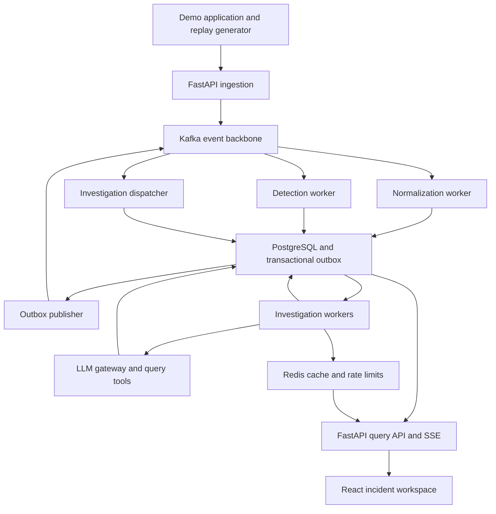

# Architecture

> Status: planned design. The source is [SignalOps_Implementation_Plan.md](SignalOps_Implementation_Plan.md) §2–3 and §10. Nothing described here is implemented yet.

## Overview

Agents investigate *selected incidents*. Raw signals never pass through an LLM one by one.

## Who owns which state

| Store | Owns | Does not own |
| --- | --- | --- |
| **PostgreSQL** | Normalized evidence, incidents, the temporal knowledge graph, investigations, jobs, leases, checkpoints, budgets, durable progress events, consumer receipts, the outbox, evaluation records | Nothing durable is delegated elsewhere |
| **Kafka** | Transport for accepted raw signals, normalized signal references, and domain events | Application state; queries |
| **Redis** | Disposable read caches, provider and ingestion rate limits, pub/sub wake-ups for the UI | Evidence, job state, budgets, detector windows, delivery guarantees |

Losing Redis can cause cache misses or briefly pause model calls. It must never lose an investigation, a detector window, or a progress event. See [decisions.md](decisions.md) ADR-002 and ADR-003.

## Process boundaries

All processes come from one Python codebase and one backend image, started with different entry commands. Agents are logical workflow roles, not services.

| Process | Responsibility | Scaling boundary |
| --- | --- | --- |
| `api` (FastAPI) | Ingestion, query endpoints, investigation requests, SSE | HTTP replicas |
| `normalizer` | Adapter validation, identity resolution, quality scoring | Kafka partitions |
| `detector` | Time-window rules and incident grouping | Kafka partitions plus durable detector state |
| `detector-closer` | Closes live detection windows by wall clock and evaluates their rules | Row locks with SKIP LOCKED; state is in PostgreSQL |
| `dispatcher` | Turn investigation-request events into durable jobs | Kafka partitions |
| `investigation-worker` | Claim jobs, execute workflow steps, checkpoint | Worker concurrency and model budget |
| `outbox-publisher` | Publish committed domain events to Kafka | One polling process (MVP) |
| `evaluation-runner` | Fault injection, isolated replay, scoring | Isolated evaluation runs |

FastAPI request handlers and background tasks never run heavy work. The FastAPI lifespan only opens and closes connections.

## End-to-end flow

1. **Ingest.** An adapter posts a batch with stable `source_event_id`s. The API validates size and credentials, redacts configured fields, and publishes to `signals.raw.v1`. Each record is accepted only after the broker acknowledges it, and partial outcomes are reported per record.
2. **Normalize.** The normalizer validates the payload, resolves service and environment, and assigns quality flags. In one transaction it inserts the normalized signal, the consumer receipt, and an outbox row. It commits the Kafka offset only after that transaction commits.
3. **Detect.** The detector loads evidence for each normalized reference, updates durable window aggregates, and upserts an incident by fingerprint and correlation window when a rule crosses its threshold, in one transaction with its outbox event. Investigations start manually at first; automatic requests come after Phase 6.
4. **Dispatch.** The dispatcher persists one job per investigation before it acknowledges the request. Kafka consumption never waits on the LLM workflow.
5. **Investigate.** A worker claims the job with a short lease and runs the checkpointed workflow. Specialists query bounded evidence windows and graph neighborhoods. A verifier checks claim support and output shape. The result is a structured diagnosis or `insufficient_evidence`.
6. **Observe.** Progress events stream to the UI over SSE, with PostgreSQL providing durable replay. After a human applies a fix in the demo app, SignalOps observes recovery and records the outcome.

## Scope invariants

Every query, graph traversal, tool call, and cache key carries three values:

- **Workspace.** One workspace initially, but scope is enforced from day one.
- **Replay scope.** `live`, or an isolated evaluation run ID.
- **Evidence cutoff.** The incident time. Agents cannot see future signals.

## Deployment shape

Docker Compose runs these core services: `frontend`, `api`, `normalizer`, `detector`, `detector-closer`, `dispatcher`, `investigation-worker`, `outbox-publisher`, `postgres`, `redis`, `kafka`.

- One-shot `migrate` and `init-topics` services handle schema and topic setup.
- The optional profiles are `demo` (an instrumented app, possibly the OpenTelemetry Demo), `evaluation`, and `observability`.
- Stateful services use named volumes and private networks. PostgreSQL, Kafka, and Redis are never exposed publicly.
- Single-node Kafka (replication factor 1) and local volumes do **not** protect against host or disk loss.

## Related documents

- [events.md](events.md): topic contracts and delivery rules
- [data-model.md](data-model.md): tables and constraints
- [agents-and-workflow.md](agents-and-workflow.md): the investigation runtime
- [reliability.md](reliability.md): recovery guarantees and failure tests
