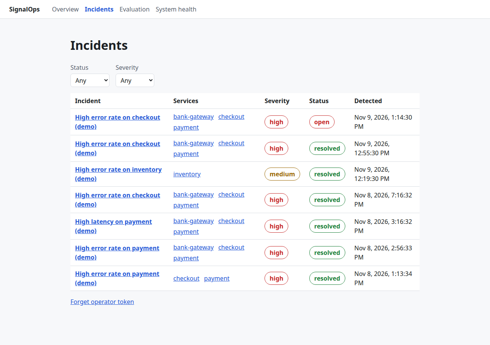
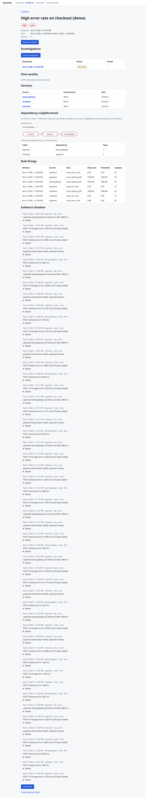
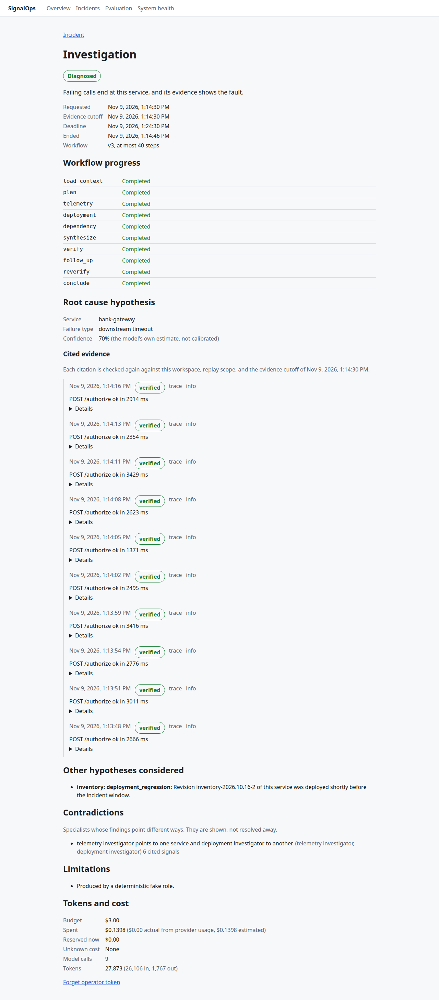
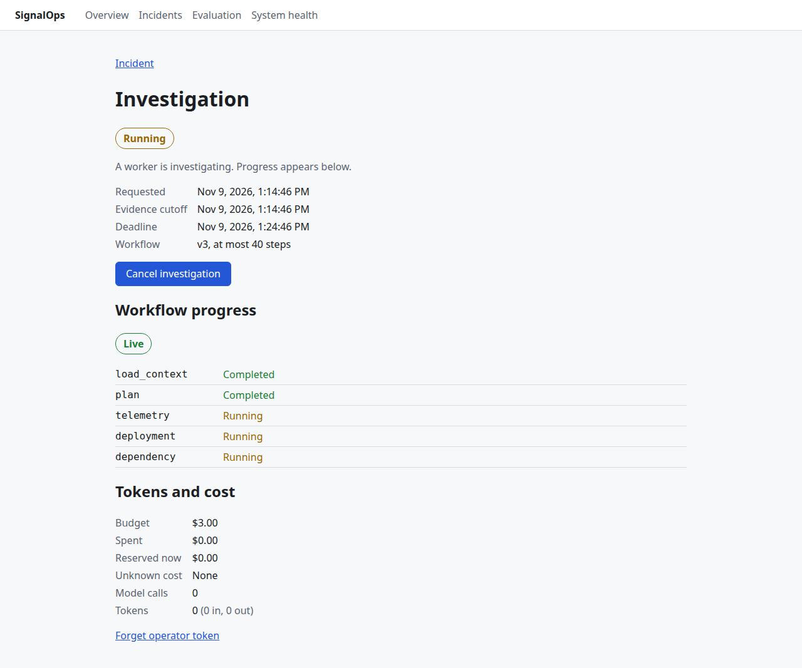
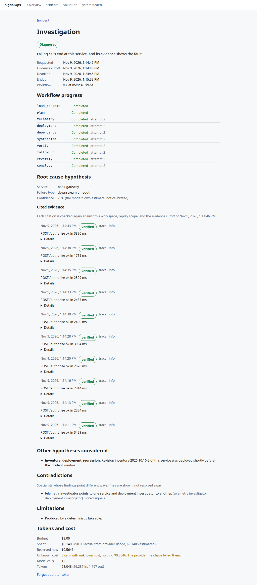
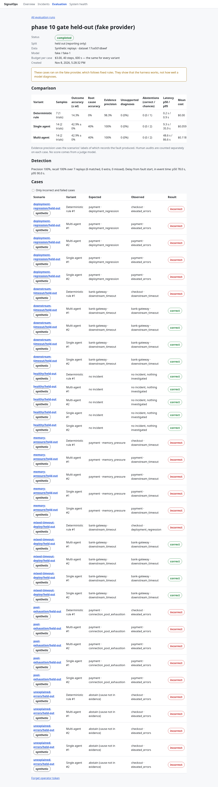

# Demonstration

What SignalOps does, shown on one injected fault, and what each claim rests on. Every step can be reproduced with the [quick start](quickstart.md); the screenshots were captured from the Compose stack by `apps/web/e2e/demo.e2e.ts` (see [Reproducing the capture](#reproducing-the-capture)).

## Read this first

- **The data is synthetic.** Telemetry comes from the demo generator (`signalops demo-generate`) or the small `demo-shop` application, both built for this project. No production system was observed.
- **The model is a deterministic fake.** Every investigation shown here and every recorded evaluation ran on the fake provider. Its roles answer by fixed rules over the evidence they are given. It demonstrates the runtime (durable jobs, budgets, checkpoints, citation checks, recovery) and **nothing about diagnostic quality**. A Claude adapter exists; no paid model run is part of these results.
- **One development host.** Single-node Kafka and PostgreSQL on one laptop (AMD Ryzen 5 7640HS, 12 logical CPUs, 24.7 GiB RAM). No high-availability, capacity, or production claim follows from it.
- **Costs are estimates.** Fake calls are priced from token counts with the configured price table and are never billed.

## The narrative

### 1. Inject a fault into noisy telemetry

```bash
docker compose --profile demo run --rm demo \
  demo-post downstream-timeout --realtime --duration-s 300 --api-url http://api:8000
```

Five minutes of traffic for five services (`checkout`, `payment`, `inventory`, `bank-gateway`, `orders-db`): trace summaries, structured logs, and one deployment of `inventory`, with background warnings and errors on healthy services. Between 40% and 80% of the run, `bank-gateway` slows and `payment` calls time out. The records do not name the scenario or the fault; the labels are written to a separate file the runtime cannot read.

Every record goes through `POST /v1/ingest/{source}` and is reported `accepted` only after Kafka acknowledged it (472 of 472 in the [quick-start run](quickstart.md)). The normalizer resolves each record's service, flags data quality, and stores it once even when it is delivered twice.

### 2. The detector opens one incident



The list was captured on the development stack, so it also holds earlier demo incidents, now resolved, and one *High error rate on inventory* from the 30-minute benchmark's healthy traffic (a known false positive, see [Not claimed](#not-claimed)). The new incident is the open one at the top.

About two minutes into the fault, a one-minute window closes with an error rate above its rule's threshold. The detector opens one incident for the affected services and, in the same transaction, requests an investigation.



The incident page shows the rule firings, the services and their roles, the evidence timeline of cited signals, data quality per source, and the dependency neighborhood observed from traces at incident time.

### 3. A diagnosis with evidence



The automatic investigation runs workflow `v3`: a coordinator plans, three specialists (telemetry, deployment, dependency) investigate in parallel with read-only tools bounded by workspace, replay scope, and the evidence cutoff, a synthesizer combines their findings, and a verifier checks each claim's support. The diagnosis names a root-cause service and failure type with cited signals. Each citation was checked in PostgreSQL to exist in scope and before the cutoff; the page marks them *verified*. The unrelated `inventory` deployment appears as an alternative hypothesis and a recorded contradiction between specialists. Usage shows model calls, tokens, and the estimated cost against the 3 USD budget reserved before each call.

With a real model, an investigation can also end *insufficient evidence*, listing what is missing; that is a valid outcome, not a failure.

### 4. A worker dies mid-investigation and the run resumes



A second investigation is started, and the worker process is killed (`docker compose kill investigation-worker`) after two workflow steps completed. The steps already done are durable checkpoints; the step in progress stops.



After the lease expires (30 s), the restarted worker claims the job with a new lease generation. It reuses the completed steps, reruns the rest (marked *attempt 2*), and stores the diagnosis. Writes from the dead worker's generation would be rejected. The model calls that were in flight are recorded with *unknown cost* and keep their budget reservation, because a real provider may have billed them.

### 5. Comparison against simpler baselines



The evaluation lab replays seven held-out scenarios into isolated replay scopes and investigates each with three variants under the same evidence cutoff, tools, and limits (3 USD, 40 steps, 600 s per case): `d1` deterministic rules without a model, `v2` one tool-using agent, `v3` the multi-agent workflow. Run `7ac381af` ([retained result](evaluation-runs/7ac381af-heldout-fake.json)), fake provider, 2 trials for the agents:

| Variant | Outcome accuracy | Root-cause accuracy | Evidence precision (labels) | Model calls | Estimated cost per case | Latency p50 / p95 |
| --- | --- | --- | --- | --- | --- | --- |
| `d1` deterministic | 1/7 | 0/5 | 59/60 | 0 | 0 | 0.2 s / 0.9 s |
| `v2` single agent | 6/14 (σ 0.0) | 4/10 | 120/120 | 30 | 0.060 USD | 9.3 s / 35.9 s |
| `v3` multi-agent | 6/14 (σ 0.0) | 4/10 | 120/120 | 102 | 0.119 USD | 48.6 s / 86.6 s |

Detection, shared by all variants: 6 of 6 faults matched, no extra incidents on the healthy scenario, event-time delay p50 78 s, p95 90 s.

**What this shows:** the harness runs all three variants on identical evidence and limits, scores them against labels the runtime cannot read, and reports correctness next to cost and latency. **What it does not show:** whether agents beat rules, or whether multi-agent beats single-agent. The agents' answers come from the fake provider's fixed rules, so their accuracy is a property of those rules. On this run `v3` cost twice as much as `v2` for the same result; whether multi-agent execution earns its cost is untested until paid trials run.

## Claims and evidence

Each capability the README and documentation claim, and where it is shown or verified. Integration tests run against real PostgreSQL, Kafka, and Redis (`SIGNALOPS_INTEGRATION=1`); the full suite last passed with 1,364 tests during P11-T05.

| Claim | Shown in | Verified by |
| --- | --- | --- |
| Records are accepted only after Kafka acknowledges them; a broker outage reports nothing accepted | Step 1 | `tests/integration/test_ingestion_api.py`; Kafka outage in `tests/integration/test_outages.py` ([reliability.md](reliability.md#outage-checks-p11-t03)) |
| Duplicates and redeliveries produce one logical record | | `tests/integration/test_consumer_transactions.py` (crash between DB and offset commit), `test_normalizer.py`, duplicate posts in `test_outages.py` |
| The outbox publishes only committed changes, and a crash after broker acknowledgement is harmless | | `tests/integration/test_outbox_publisher.py` |
| Every accepted record ends processed or explicitly quarantined, across Kafka, PostgreSQL, and Redis outages and rebalances | | `tests/integration/test_outages.py`, `streaming/reconcile.py`; 1,000,000 and 178,558 records reconciled in the [benchmark reports](benchmarks.md) |
| Detection windows are durable; late and out-of-order samples are handled by recorded closure rules | Step 2 | `tests/integration/test_detector.py`, `test_incidents.py`; [ADR-015, ADR-016](decisions.md#adr-016-rules-evaluate-at-window-closure-with-lateness-judged-from-durable-clocks) |
| A fault produces one correlated incident and one automatic investigation | Steps 2–3 | `tests/integration/test_incidents.py`, `test_investigation_requests.py`; quick-start run (P12-T01 notes in the roadmap) |
| Temporal service graph in PostgreSQL with bounded traversal | Step 2 (graph) | `tests/integration/test_graph.py`, `test_incident_api.py` |
| Investigation requests are acknowledged once persisted and are idempotent | | `tests/integration/test_investigation_requests.py`; [API examples](api.md#examples) (same key → same investigation, different body → 409) |
| Tools are read-only and cannot see other workspaces, other replay scopes, or evidence after the cutoff | Step 3 | `tests/integration/test_agent_tools.py`, `test_evidence_api.py` |
| Citations are verified; unsupported claims are not stored | Step 3 (*verified*) | `tests/integration/test_investigator.py`, `test_synthesis_verification.py`; [ADR-029](decisions.md#adr-029-citations-are-verified-in-postgresql-and-cached-reads-prove-their-identity) |
| Budgets are reserved in PostgreSQL before each call, including parallel calls; ambiguous outcomes keep their reservation | Steps 3–4 | `tests/integration/test_model_gateway.py`, `test_gateway_failures.py`, `test_parallel_branches.py` |
| Throttling, timeouts, malformed output, and budget exhaustion are handled on the fake provider | | `tests/integration/test_gateway_failures.py`; `fixtures/gateway/v1` |
| A killed worker's job resumes with completed steps reused and stale writes rejected | Step 4 | `tests/integration/test_workflow_recovery.py`, `test_job_leases.py`, `test_multi_agent_recovery.py`; worker kill in `test_outages.py` |
| Cancellation and deadlines end investigations durably | | `tests/integration/test_cancellation.py`; browser journey `apps/web/e2e/journey.e2e.ts` |
| Live progress survives reconnects and Redis loss | | `tests/integration/test_progress_stream.py`; reload mid-run in `journey.e2e.ts` |
| Log and runbook text cannot grant tool permissions (prompt injection) | | `tests/integration/test_prompt_injection.py` |
| Evaluation ground truth is unreadable by the runtime role; replays are isolated | Step 5 | `tests/integration/test_evaluation_access.py`, `test_replay.py` |
| Three baselines under equal limits, scored against labels | Step 5 | `tests/integration/test_evaluation_runs.py`, `test_evaluation_api.py`; [run 7ac381af](evaluation-runs/7ac381af-heldout-fake.json); `apps/web/e2e/evaluation.e2e.ts` |
| Operator routes require operator credentials; credentials rotate without restart | | `tests/unit/test_route_security.py`, `tests/unit/test_credentials.py`; [security.md](security.md) |
| Backups restore every durable row; retention never removes cited evidence | | `tests/integration/test_backup_restore.py`, `test_retention.py`; [retention.md](retention.md) |
| One million records replayed and reconciled; 30-minute API run at 99.2 records/s | | [benchmarks.md](benchmarks.md), `docs/benchmarks/replay-1m.json`, `docs/benchmarks/sustained-100.json` |
| An investigation can be followed from ingestion batch to model calls | | `GET /v1/investigations/{id}/trace` ([example](api.md#examples)); `tests/integration/test_observability.py` |

## Not claimed

- **Diagnostic quality or a benefit from agents.** No paid model has run. The comparison above is a harness demonstration.
- **Multi-agent value.** Untested; on the fake provider it doubled cost for the same accuracy.
- **100 records/s for 30 minutes.** The sustained run reached 99.2 records/s because of a generator shortfall, which was fixed, and the run was not repeated ([benchmarks.md](benchmarks.md#results)).
- **Throughput beyond one host.** The replay was limited by one normalizer partition at about 119 records/s; the larger tuning levers are recorded and not applied.
- **Detection quality under heavy healthy load.** The replay benchmark produced 15 false inventory incidents with ten times the demo traffic; the cause is not investigated.
- **High availability, durability across host loss, public exposure.** Single-node Compose, no WAL archiving, no TLS or OIDC ([security.md](security.md#not-covered), [retention.md](retention.md#single-node-durability-limits)).
- **Exactly-once model execution.** Calls in flight when a worker dies may be repeated and billed again; they are recorded as unknown.

## Reproducing the capture

The screenshots come from one run of `apps/web/e2e/demo.e2e.ts` against the Compose stack with the fake provider. It posts the fault, waits for the incident, opens the automatic investigation, starts a second one and kills the worker after two completed steps, waits for the resumed result, and opens the newest completed evaluation run. It also records a video to `apps/web/e2e-results/` (not committed).

```bash
# Stack from the quick start, with SIGNALOPS_FAKE_MODEL_DELAY_SECONDS=3 in .env
# (then `docker compose up -d investigation-worker`), and one completed evaluation run:
docker compose --profile evaluation up -d evaluation-worker
curl -s -X POST -H "Authorization: Bearer $OPERATOR_TOKEN" -H 'Content-Type: application/json' \
  -d '{"label": "held-out (fake provider)", "trials": 2}' http://127.0.0.1:8010/v1/evaluation-runs
# about 7 minutes later the run is completed; then, from apps/web:
pnpm install --frozen-lockfile
pnpm exec playwright install chromium ffmpeg     # or E2E_BROWSER_CHANNEL=chrome for an installed Chrome
E2E_DEMO_CAPTURE=1 E2E_OPERATOR_TOKEN="$OPERATOR_TOKEN" pnpm exec playwright test demo
```

It takes about eight minutes, kills and restarts the `investigation-worker` container, and overwrites `docs/demo/*.png`.
